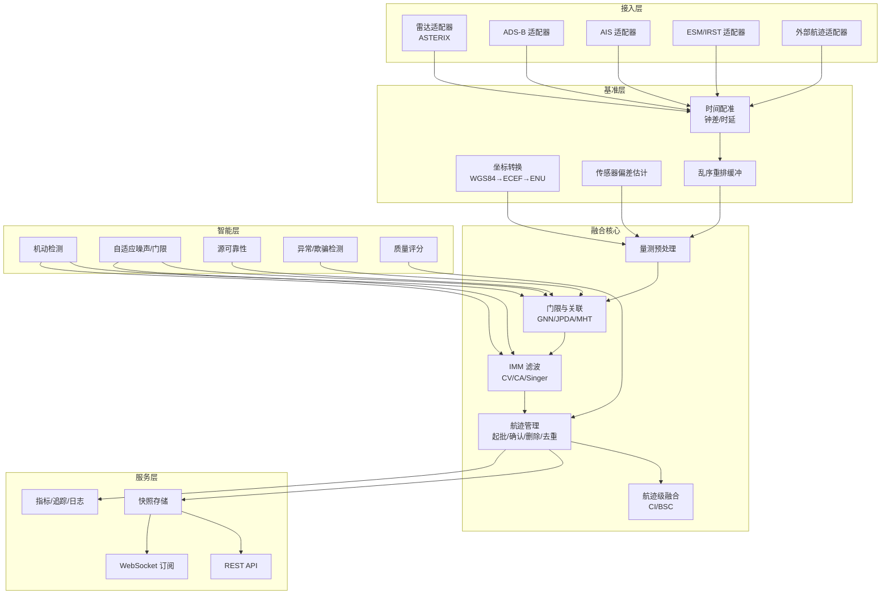
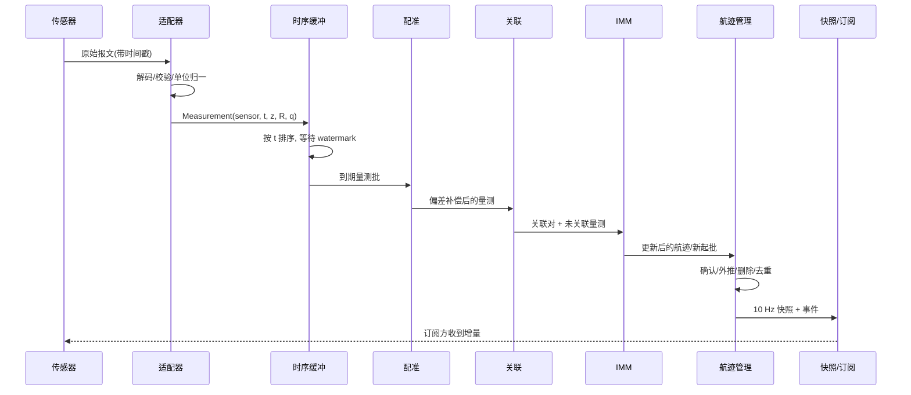
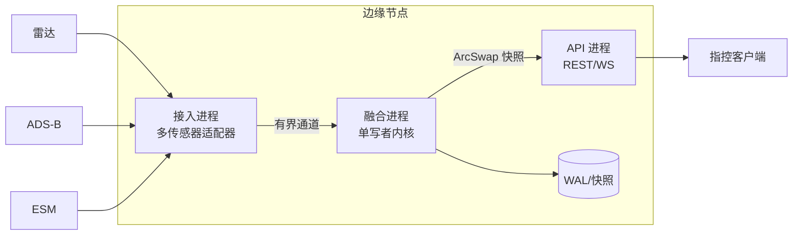
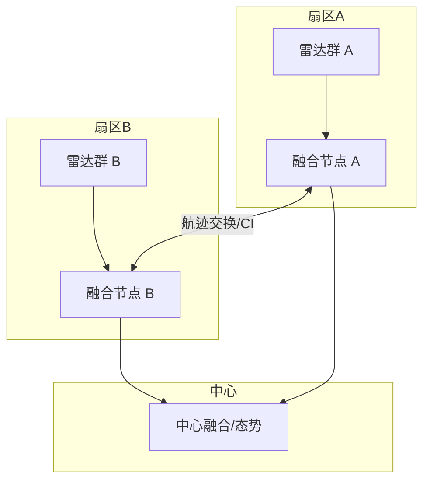
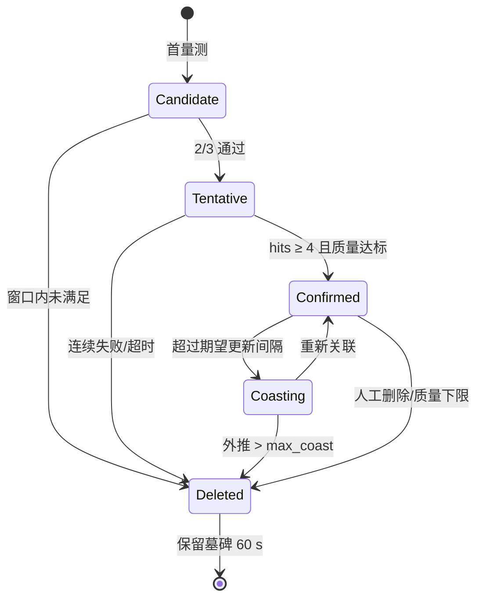
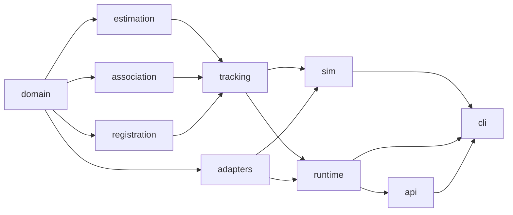

# 基于 Rust 的智能化多源航迹融合系统设计方案

> 文档版本：1.0（设计评审稿）  
> 日期：2026-11-19  
> 适用范围：区域空中目标监视，可扩展至海面与地面目标  
> 算法细节与智能化选型见 [FUSION_ALGORITHMS.md](FUSION_ALGORITHMS.md)；智能关联算法 AGPA 见 [INTELLIGENT_ASSOCIATION.md](INTELLIGENT_ASSOCIATION.md)。  
> 读者：系统架构师、融合算法工程师、Rust 后端工程师、测试与运维人员

---

## 目录

1. [摘要](#1-摘要)
2. [范围、术语与假设](#2-范围术语与假设)
3. [需求与目标](#3-需求与目标)
4. [总体架构](#4-总体架构)
5. [领域模型与数据契约](#5-领域模型与数据契约)
6. [处理流水线](#6-处理流水线)
7. [数据关联](#7-数据关联)
8. [状态估计](#8-状态估计)
9. [多源融合](#9-多源融合)
10. [航迹管理](#10-航迹管理)
11. [智能化设计](#11-智能化设计)
12. [Rust 工程架构](#12-rust-工程架构)
13. [接口设计](#13-接口设计)
14. [存储、回放与评估](#14-存储回放与评估)
15. [部署与运维](#15-部署与运维)
16. [性能与容量](#16-性能与容量)
17. [测试与验收](#17-测试与验收)
18. [安全与合规](#18-安全与合规)
19. [风险与演进路线](#19-风险与演进路线)
20. [附录](#20-附录)

---

## 1. 摘要

本方案设计一套以 Rust 实现的、面向多传感器多目标场景的智能化航迹融合系统，代号 **SkyFusion**。系统将一次雷达、二次雷达/ADS-B、AIS、电子侦察（ESM）、红外搜索跟踪（IRST）以及外部融合节点送来的异构量测与局部航迹，统一到同一时间基准与局部 ENU 坐标框架内，经过"配准—关联—滤波—融合—航迹管理"流水线，输出全局唯一、连续、可解释的融合航迹。

设计上有四个核心取舍：

1. **确定性融合内核与异步 I/O 分离**。融合核心是单写者、无锁、无 I/O 的纯状态机，所有网络、存储、序列化都在外围；相同输入、相同配置、相同随机种子，在同一构建与硬件平台上得到逐位相同的结果，便于回放、复盘与责任追溯。
2. **以 IMM + 9 维统一状态为核心估计器**。CV/CA/Singer 三个模型共享 `[位置, 速度, 加速度]` 状态，避免模型维度不一致带来的混合复杂度；机动检测与自适应过程噪声作为"智能层"叠加在估计器之上。
3. **量测级融合与航迹级融合并存，按拓扑自动选择**。同覆盖、可实时对齐的传感器走量测级融合；跨节点、跨区域或只有局部航迹的场景走航迹级融合，默认使用协方差交叉（CI）以避免未知互相关导致的过自信。
4. **智能策略全部可解释、有边界、可回退**。自适应门限、过程噪声、源可靠性、异常检测都由明确的统计量驱动，并输出证据；在线学习默认只在影子模式运行，不直接进入闭环。

系统以 Rust workspace 组织，核心 crate 不依赖 Tokio/Axum，可独立做单元测试、模糊测试与形式化边界检查；服务层基于 Tokio 与 Axum 提供 REST/WebSocket 接口，可在单节点 4 vCPU/4 GB 环境支撑 20 部传感器、500 批确认目标（航迹总量 1000 批）、10 Hz 融合输出，内核处理时延 p95 ≤ 50 ms。

---

## 2. 范围、术语与假设

### 2.1 目标场景

- **区域防空/要地防御**：多部一次雷达、二次雷达、ADS-B 地面站、ESM 站共同监视空域，融合中心输出统一航迹，供指挥控制与武器分配使用。
- **低空通航/城市空中交通**：雷达与 ADS-B 覆盖互补，重点解决低空盲区、欺骗与航迹断续。
- **海上交通监视**：岸基雷达与 AIS 融合，识别船只与异常行为（本方案保留扩展点，不展开海面模型）。
- **多融合节点协同**：每个节点负责一个扇区，节点间交换航迹，通过航迹级融合形成大范围态势。

### 2.2 术语

| 术语 | 英文 | 含义 |
|---|---|---|
| 量测 | Measurement | 传感器一次观测，含时间、坐标、协方差、质量 |
| 局部航迹 | Local Track | 单传感器或单节点跟踪器输出的航迹 |
| 融合航迹 | Fused Track | 系统级唯一航迹，对外发布 |
| 关联 | Association | 判定量测与航迹、或航迹与航迹的对应关系 |
| 起批 | Track Initiation | 由量测建立新航迹 |
| 外推 | Coasting | 无新量测时仅做预测维持航迹 |
| 时空配准 | Registration | 统一时间基准与空间基准，估计传感器偏差 |
| 杂波 | Clutter | 非目标引起的虚警量测 |
| 漏检 | Missed Detection | 目标存在但未被检测 |
| 乱序量测 | Out-of-Sequence Measurement (OOSM) | 时间戳早于当前处理时刻的迟到量测 |
| 协方差交叉 | Covariance Intersection (CI) | 未知互相关下的保守融合 |
| OSPA | Optimal Subpattern Assignment | 多目标跟踪综合距离指标 |

### 2.3 设计假设

- 目标以空中平台为主，速度范围 0–1200 m/s，高度 0–25 km；海面/地面目标通过扩展运动模型支持。
- 传感器时间戳由传感器侧 GPS/PTP 打标；无硬件打标时，由接入层按到达时间估计并标注不确定度。
- 各传感器覆盖范围存在重叠，但重叠关系随部署变化；系统不假设固定的传感器拓扑。
- 融合节点部署在边缘机房，具备 GPS/PTP 授时或至少 NTP 同步条件。
- 单节点确认目标 ≤ 500 批、航迹总量 ≤ 1000 批，传感器 ≤ 20 部，融合输出频率 10 Hz；超出时按扇区分片扩展。
- 系统输出用于辅助决策，不直接参与武器控制；所有自动化动作都可被人工覆盖。

---

## 3. 需求与目标

### 3.1 功能需求

| 编号 | 需求 | 说明 |
|---|---|---|
| FR-01 | 多协议接入 | 支持 ASTERIX CAT010/048/062、ADS-B/Mode S、AIS NMEA、自定义 JSON/Protobuf、外部航迹 |
| FR-02 | 时空配准 | WGS84/ECEF/ENU 转换；传感器钟差、传输时延、位置/距离/方位偏差估计与补偿 |
| FR-03 | 多目标跟踪 | 起批、确认、外推、删除；支持交叉、并行、机动、密集杂波场景 |
| FR-04 | 数据关联 | 门限 + GNN/Hungarian，密集杂波下 JPDA，可选 MHT；航迹间关联 |
| FR-05 | 状态估计 | CV/CA/Singer IMM；极坐标 EKF；纯方位 UKF；OOSM 处理 |
| FR-06 | 多源融合 | 量测级融合、航迹级融合（CI/BSC）、源权重自适应、重复计数抑制 |
| FR-07 | 航迹管理 | 统一 ID、别名、去重合并、生命周期、质量评分、来源溯源 |
| FR-08 | 智能增强 | 机动检测、自适应噪声/门限、源可靠性评估、异常与欺骗检测 |
| FR-09 | 服务接口 | REST 查询、WebSocket 订阅、批量接入、配置热更新、健康与指标 |
| FR-10 | 回放与评估 | 原始量测录制回放、确定性重放、OSPA/RMSE/ID 切换等指标 |
| FR-11 | 仿真验证 | 场景化目标/传感器/杂波仿真，蒙特卡洛批量评估 |
| FR-12 | 可观测性 | 结构化日志、分布式追踪、Prometheus 指标、审计事件 |

### 3.2 非功能需求与 SLO

| 编号 | 指标 | 目标值 | 测量方式 |
|---|---|---|---|
| NFR-01a | 内核处理时延 | p95 ≤ 50 ms，p99 ≤ 100 ms | 量测离开重排缓冲到快照发布 |
| NFR-01b | 端到端时延 | 默认 p95 ≤ 600 ms；`reorder_lag_ms = 100` 时 p95 ≤ 200 ms | 量测事件时间到快照发布 |
| NFR-02 | 融合输出频率 | 10 Hz（可配 1–50 Hz） | 快照序列 |
| NFR-03 | 吞吐 | 20 传感器 × 50 msg/s = 1000 msg/s 持续；突发 5000 msg/s 不丢关键量测 | 接入计数器 |
| NFR-04 | 容量 | 500 确认航迹 + 500 暂定航迹 | 运行时快照 |
| NFR-05 | 乱序容忍 | 固定滞后 500 ms；迟到 ≤ 2 s 可回填；> 2 s 拒绝并计数 | OOSM 指标 |
| NFR-06 | 可用性 | 99.9%（单节点），故障恢复 RTO ≤ 5 s，RPO ≤ 1 s | 演练 |
| NFR-07 | 确定性 | 同输入/配置/种子，输出哈希一致 | 回放测试 |
| NFR-08 | 资源占用 | 4 vCPU/4 GB 下单节点 CPU 平均 ≤ 50%，内存 ≤ 2 GB | 压测 |
| NFR-09 | 可维护性 | 核心 crate 单元测试覆盖率 ≥ 80%，无 `unsafe` | CI |
| NFR-10 | 可解释性 | 每条融合航迹可追溯来源、关联证据、模型概率 | API 字段 |

### 3.3 非目标

- 不实现传感器硬件控制、天线调度与波形设计。
- 不实现武器分配、交战决策与指挥控制业务流程。
- 不内置深度学习训练平台；在线学习仅作为可选增强，且默认影子运行。
- 不承诺跨操作系统硬实时；微秒级确定性由独立实时子系统承担。

---

## 4. 总体架构

### 4.1 设计原则

1. **核心纯净**：融合算法不依赖网络、时钟、文件系统与异步运行时；时间、随机数、配置全部注入。
2. **单一写者**：每个融合区域只有一个写者持有航迹状态，杜绝锁竞争与状态撕裂。
3. **边界校验**：所有外部输入在进入内核前完成结构、量纲、范围、协方差正定性校验。
4. **失败隔离**：单传感器解码失败、单条量测异常不得影响其他传感器与全局融合。
5. **可回放**：原始输入、配置哈希、随机种子、软件版本四元组决定一次运行，可逐位复现。
6. **渐进增强**：GNN → JPDA → MHT、KF → IMM → 自适应、规则 → 学习，均以配置开关灰度启用。

### 4.2 分层架构



**各层职责**

| 层 | 职责 | 不做什么 |
|---|---|---|
| 接入层 | 协议解码、字段映射、单位归一、原始报文留存 | 不做关联、不做滤波 |
| 基准层 | 时间对齐、坐标转换、偏差补偿、乱序重排 | 不改变量测语义 |
| 融合核心 | 关联、估计、融合、航迹生命周期 | 不做网络 I/O、不读系统时钟 |
| 智能层 | 参数自适应、异常检测、质量评估、证据输出 | 不直接修改航迹状态，只给核心提供建议 |
| 服务层 | 快照发布、查询、订阅、配置、可观测性 | 不持有融合状态 |

### 4.3 数据流



**关键数据流规则**

- 量测以 `(event_time, sensor_id, sequence)` 全序排列，确保回放确定性。
- 融合节拍独立于量测到达：每 100 ms 触发一次快照；量测在节拍内按时间顺序处理。
- 每个量测只被消费一次；关联失败的量测进入起批候选，不重复参与同一节拍的关联。
- 快照是只读的不可变对象，通过原子指针切换，API 读取不加锁。

### 4.4 部署形态

**单节点（默认）**



- 接入、融合、API 可以是同进程内的三个 Tokio 任务组，也可以拆为三个进程；默认同进程降低运维成本，故障隔离要求高时拆分。
- 融合核心运行在专用线程（`std::thread` + 阻塞循环），不进入 Tokio 调度器，避免异步任务抖动影响节拍。

**多节点（扇区协同）**



- 扇区间只交换**航迹级**信息（状态、协方差、来源集合、质量），不交换原始量测，降低带宽与耦合。
- 航迹跨区时执行**交接协议**：源节点发送 `handover` 事件，目标节点建立影子航迹并做 T2T 关联，确认后源节点降级为外推并最终删除。
- 中心节点只做态势聚合与长航时融合，不参与实时关联，避免单点瓶颈。

### 4.5 技术选型

| 关注点 | 选择 | 理由 |
|---|---|---|
| 语言 | Rust 2024 edition | 内存安全、无 GC 抖动、强类型领域建模 |
| 数值 | `nalgebra` 固定维矩阵 | 9×9/3×3 编译期定长，避免动态分配；成熟 SVD/Cholesky |
| 异步运行时 | Tokio | 生态成熟，适合接入与 API |
| HTTP/WS | Axum | 轻量、类型安全、与 Tokio 集成好 |
| 序列化 | Serde + JSON（外部）/ Protobuf（内部与 WAL） | 调试友好与紧凑兼顾 |
| 配置 | TOML + 环境变量覆盖 | 可读、可版本化 |
| 日志/追踪 | `tracing` + OpenTelemetry | 结构化、可关联量测 ID |
| 指标 | Prometheus 文本格式 | 运维标准 |
| 存储 | 本地 WAL + 可选 S3/Parquet | 热路径不依赖数据库 |
| 仿真 | 自研离散事件仿真器 | 可控真值、可重复 |
| 测试 | `cargo test` + `proptest` + `criterion` + `cargo-fuzz` | 正确性、属性、性能、健壮性 |

### 4.6 运行模式

| 模式 | 输入 | 输出 | 用途 |
|---|---|---|---|
| 实时融合 | 传感器实时流 | 快照、订阅、告警 | 生产运行 |
| 回放复盘 | 录制清单（量测 + 配置 + 版本） | 快照、指标、差异报告 | 事故复盘、算法回归 |
| 仿真评估 | 场景配置 + 随机种子 | 真值、量测、指标 | 参数标定、验收 |
| 影子对比 | 生产流（只读） | 双版本差异报告 | 灰度发布、模型评估 |
| 降级运行 | 受限输入（部分传感器） | 保守航迹 | 故障/过载 |

- 五种模式共用同一融合内核，差异只在输入源、时钟与输出汇；避免"仿真一套、生产一套"。
- 影子模式不允许写生产快照与 WAL，只写独立的对比通道。

---

## 5. 领域模型与数据契约

### 5.1 时空基准

**时间**

- 统一使用 **UTC 微秒**（`i64`）作为绝对时间，避免浮点比较与累积误差。
- 领域内所有时间运算转换为 `f64` 秒进行，但排序、超时、窗口判断使用整数微秒。
- 每个传感器维护 `clock_offset_us` 与 `latency_us`：
  - 有硬件时间戳：偏移由 PTP/NTP 守护进程提供，融合层只读。
  - 无硬件时间戳：以到达时间减去估计传输时延；时延初值由配置给出，运行中用关联残差的自相关峰估计并缓慢修正。
- 时间质量分级：`Hardware`、`Synced`、`Estimated`、`Unknown`，参与融合权重。

**空间**

- 全局基准：WGS84 椭球。
- 融合状态：以扇区参考点为原点的 **ENU** 直角坐标，单位米。
- 坐标链路：`WGS84 → ECEF → ENU`，反向 `ENU → ECEF → WGS84`；全部使用双精度，往返误差目标 < 1 mm。
- ENU 有效范围：以参考点为中心 200 km。ENU 是切平面坐标，原点过远会放大数值量级并增加跨区拼接误差；目标跨越扇区时重设原点并同步变换状态与协方差。对超过 100 km 的目标，超过 60 s 的长时外推应改用 ECEF 或大圆航线校验，不能把切平面直线当成真实航迹。
- 传感器局部坐标：极坐标 `(r, az, el)`，方位角从真北顺时针，俯仰角从水平面向上；支持安装偏航角与水平/俯仰安装偏差。

### 5.2 核心类型（设计契约）

以下是类型层面的设计，不绑定具体实现：

```rust
/// 绝对时间：UTC 微秒。
pub struct Timestamp(i64);

pub struct SensorId(String);
pub struct TrackId(u64);

/// 九维状态：ENU 下的位置、速度、加速度。
/// [x, y, z, vx, vy, vz, ax, ay, az]
pub type State = SVector<f64, 9>;
pub type Covariance = SMatrix<f64, 9, 9>;

pub enum MeasurementKind {
    /// 直角坐标位置（ADS-B、外部航迹、已转换的雷达点迹）
    Position { frame: Frame, position: Vector3<f64>, covariance: Matrix3<f64> },
    /// 极坐标（一次雷达、二次雷达）
    Polar {
        origin: GeoPoint,
        range_m: f64, azimuth_rad: f64, elevation_rad: f64,
        sigma_range_m: f64, sigma_azimuth_rad: f64, sigma_elevation_rad: f64,
    },
    /// 纯方位（ESM、IRST）
    Bearing {
        origin: GeoPoint,
        azimuth_rad: f64, elevation_rad: f64,
        sigma_azimuth_rad: f64, sigma_elevation_rad: f64,
    },
}

pub struct Measurement {
    pub sensor: SensorId,
    pub time: Timestamp,
    pub kind: MeasurementKind,
    pub quality: f64,              // [0,1]，源可信度与量测健康度
    pub attributes: BTreeMap<String, String>, // 呼号、地址码、批号、原始报文引用
}
```

**两坐标雷达的处理**

对只有距离/方位的两坐标雷达，适配器将 `elevation_rad` 置 0、`sigma_elevation_rad` 取较大值（如 0.3 rad），融合层按极坐标 EKF 处理；若传感器完全无俯仰信息，建议扩展为 `RangeAzimuth` 变体，避免用一个虚假的仰角量测污染高度通道。对外发布时高度通道的方差应显式反映这种不可观测性。

**为什么用 9 维统一状态**

- 若每个运动模型使用不同维度（CV 6 维、CA 9 维、CT 10 维），IMM 混合需要维度变换与协方差投影，容易引入数值误差，且代码复杂度随模型数平方增长。- 统一 9 维后，CV 模型在预测时把加速度置零、过程噪声只作用于位置/速度；CA 与 Singer 模型使用完整加速度状态。三者共享同一状态空间，混合、更新、输出完全一致。
- 代价是 CV 模型多存 3 个恒零分量，内存与计算开销可忽略（9×9 对现代 CPU 是微小成本）。

### 5.3 量测契约

| 字段 | 类型 | 约束 | 说明 |
|---|---|---|---|
| `sensor` | string | 非空、≤64 字符 | 与配置中的传感器 ID 一致 |
| `time` | i64 µs | 有限、非未来超过 5 s | 事件时间，非到达时间 |
| `kind` | enum | 三选一 | 位置/极坐标/纯方位 |
| `quality` | f64 | [0,1] | 由适配器按信噪比、CRC、地址校验给出 |
| `attributes` | map | ≤32 项 | 不参与算法，仅透传与审计 |

**校验规则（进入内核前强制执行）**

1. 时间戳有限，且落在允许窗口内：实时模式不早于启动时间、不晚于当前时间 + 5 s；回放模式按录制窗口校验。
2. 位置分量有限；大地坐标纬度 ∈ [-90, 90]、经度 ∈ [-180, 180]。
3. 协方差对称、有限、正定；条件数 > 1e12 时拒绝并计数。
4. 极坐标距离 > 0，角度有限，标准差 > 0 且小于物理上限（如方位 σ ≤ 0.5 rad）。
5. 质量分在 [0,1]；超出则截断并记审计事件。

### 5.4 航迹契约

对外发布的航迹至少包含：

| 字段 | 说明 |
|---|---|
| `track_id` | 全局唯一、单调递增、不复用 |
| `status` | tentative / confirmed / coasting / deleted |
| `time` | 估计时刻（UTC µs） |
| `geodetic` | 纬度、经度、高度 |
| `position_enu_m` / `velocity_enu_mps` / `acceleration_enu_mps2` | ENU 状态 |
| `covariance` | 9×9 协方差（或位置/速度分块） |
| `quality` | [0,1] 综合质量 |
| `classification` | unknown/friend/hostile/neutral/civil |
| `sources` | 贡献量测的传感器集合 |
| `hits` / `misses` | 关联成功/失败计数 |
| `age_s` / `coast_s` | 航迹年龄/外推时长 |
| `maneuver` | [0,1] 机动强度 |
| `model_probabilities` | IMM 各模型后验概率 |
| `evidence` | 关联证据：平均 NIS、源可靠性、告警标记 |

### 5.5 配置模型

配置分四层，优先级从低到高：内置默认值 → 配置文件 → 环境变量 → 命令行参数。

```toml
[tracker]
origin_lat_deg = 39.9042
origin_lon_deg = 116.4074
origin_alt_m = 43.0
fusion_interval_ms = 100
reorder_lag_ms = 500
max_measurement_age_ms = 2000

[tracker.gate]
probability = 0.999
scale = 1.0
max_distance_m = 20000.0

[tracker.association]
method = "gnn"           # gnn | jpda | mht
jpda_detection_probability = 0.9
jpda_clutter_density = 1.0e-6
jpda_max_measurements = 8
mht_max_hypotheses = 64
mht_n_scan = 5

[tracker.imm]
process_noise_scale = 1.0
initial_velocity_sigma = 120.0
initial_acceleration_sigma = 6.0
# 未列出的模型字段取该模型的默认值
models = [
  { kind = "constant_velocity", acceleration_psd = 0.4 },
  { kind = "constant_acceleration", jerk_psd = 1.5 },
  { kind = "singer", acceleration_sigma = 4.0, maneuver_time_constant = 8.0 },
]
transition = [
  [0.92, 0.06, 0.02],
  [0.08, 0.86, 0.06],
  [0.10, 0.10, 0.80],
]
initial_probabilities = [0.60, 0.25, 0.15]

[tracker.lifecycle]
initiation_hits = 2
initiation_window_ms = 1500
confirmation_hits = 4
max_coast_ms = 5000
max_track_age_s = 3600
merge_gate = 11.34
merge_cycles = 5

[tracker.fusion]
method = "ci"            # ci | bsc | measurement
ci_weight_step = 0.01
min_quality = 0.2

[tracker.registration]
enabled = true
min_samples = 50
max_samples = 2000
max_correction_m = 500.0
huber_delta = 1.5

[tracker.adaptive]
enabled = true
gate_clutter_gain = 0.5
noise_scale_min = 0.5
noise_scale_max = 4.0
maneuver_probability_threshold = 0.6
maneuver_hold_cycles = 3

# 传感器台账：接入层与配准层共用；id 必须与量测中的 sensor 一致
[[sensors]]
id = "radar-east-01"
kind = "radar"                 # radar | adsb | ais | esm | external
origin_lat_deg = 39.9900
origin_lon_deg = 116.4800
origin_alt_m = 35.0
max_range_m = 120000.0
scan_period_ms = 1000
time_offset_us = 0
latency_us = 1200
boresight_yaw_rad = 0.0
enabled = true

[[sensors]]
id = "adsb-01"
kind = "adsb"
origin_lat_deg = 39.9042
origin_lon_deg = 116.4074
origin_alt_m = 43.0
max_range_m = 300000.0
scan_period_ms = 500
time_offset_us = 0
latency_us = 300
boresight_yaw_rad = 0.0
enabled = true

[api]
bind = "0.0.0.0:8080"
max_batch = 512
ws_interval_ms = 100
```

**配置校验**：所有区间、互斥、维度在启动时校验；热更新只允许白名单字段（门限、噪声尺度、融合权重），结构性配置（传感器、坐标原点）变更需重启并重建状态。

---

## 6. 处理流水线

### 6.1 接入与解码

每个传感器一个独立适配器任务，职责：

1. 读取原始报文（UDP/TCP/TLS/消息队列）。
2. 解码为统一量测；保留原始字节到环形缓冲区，供审计与复盘。
3. 计算质量分：CRC/校验和、地址有效性、信噪比、角度/距离合理性。
4. 附加传感器 ID、接收时间、原始序列号。
5. 投递到有界通道；通道满时按策略丢弃最旧的非关键量测并计数，绝不阻塞网络读线程。

**协议适配建议**

| 协议 | 要点 |
|---|---|
| ASTERIX CAT010/048/062 | CAT010 为点迹，CAT048 为单雷达航迹，CAT062 为系统航迹；CAT010 走量测级融合，CAT048 可按点迹或局部航迹接入，CAT062 走航迹级融合 |
| ADS-B | CPR 解码、奇偶帧配对、NIC/NACp 映射为质量分；地址校验失败降权 |
| AIS | NMEA 多句拼接、MMSI 去重、SOG/COG 与位置的时间对齐；AIS 是二维位置，高度置 0 且高度方差取大值 |
| ESM/IRST | 纯方位，无距离；需要平台机动或与雷达配对才能测距 |
| 外部航迹 | 状态、协方差、来源集合、分类；必须带时间与坐标系声明 |

### 6.2 时间配准与乱序缓冲

**两级缓冲**

1. **重排缓冲**：按事件时间维护最小堆，水位线 `watermark = now - reorder_lag`；水位线之前的量测批量出队。默认滞后 500 ms，可配 100–2000 ms。
2. **迟到回填**：出队后到达且时间戳落在 `[now - max_age, watermark)` 的量测，进入 OOSM 通道：
   - 若航迹保留历史状态（默认 2 s、20 Hz），回退到量测时刻做更新，再按时间顺序重放后续状态；
   - 无历史或超出窗口，则拒绝并记 `late_dropped` 指标。
3. **未来量测**：时间戳超过 `now + 5 s` 视为时钟异常，隔离并告警。

**为什么固定滞后而不是立即处理**

- 立即处理会让先到的迟到量测破坏时间顺序，导致协方差被重复计入、航迹抖动。
- 500 ms 滞后对 10 Hz 融合相当于 5 个节拍，但只增加 0.5 s 的显示延迟，却能吸收绝大多数网络抖动与传感器批处理延迟。
- 对时延极敏感的客户，可配置 `reorder_lag_ms = 100`，代价是 OOSM 比例上升。

### 6.3 空间配准与传感器偏差

**偏差模型**

- 直角坐标传感器：加性平移偏差 `b = [Δx, Δy, Δz]`（米）。
- 极坐标传感器：距离偏差 `Δr`（米）、方位偏差 `Δaz`（弧度）、俯仰偏差 `Δel`（弧度）。
- 安装偏差：偏航角 `ψ`、水平角 `ε`，可折算为旋转矩阵。

**估计方法**

对同一目标，量测与融合航迹的残差满足：

```
z_s = h_s(x) + b_s + v_s
```

- 线性情形（位置量测）：`b_s` 的最小二乘解为残差的鲁棒均值（Huber/截尾均值）。
- 极坐标情形：以 `(Δr, Δaz, Δel)` 为参数，用 Gauss-Newton 最小化笛卡尔残差平方和；雅可比由 `∂h/∂(r, az, el)` 给出。
- 可观性：单目标匀速直线运动时，平移偏差与目标状态部分不可分辨；需要至少 3 个不同方位/距离的目标，或已知参考点。系统在样本不足时只估计、不启用。
- 稳健性：Huber 权重抑制关联错误与机动目标；样本按时间衰减；偏差超过 `max_correction_m` 时冻结并告警。
- 启用策略：新偏差估计的残差均方根比当前值改善 ≥ 15%，且样本数 ≥ `min_samples`，才原子切换；切换事件写入审计日志。

**与关联的耦合**：先用当前偏差补偿量测再关联；关联成功后用残差更新偏差估计。偏差估计与关联形成闭环，必须限制更新速率（每 30 s 最多一次），避免振荡。

### 6.4 融合节拍

每个节拍（默认 100 ms）执行：

1. 从重排缓冲取出到期量测，按时间分组（同组时间差 ≤ 1 ms）。
2. 对每组：把所有航迹预测到组时刻；执行关联；更新匹配航迹；未匹配量测进入起批候选。
3. 处理迟到量测（OOSM）。
4. 把所有航迹预测到节拍结束时刻。
5. 生命周期管理：确认、外推、删除、去重合并。
6. 质量评分、证据生成。
7. 发布不可变快照；写 WAL（异步批量）。

**节拍伪代码**

```text
on_tick(now):
    batch = reorder.drain(now - reorder_lag)
    for group in group_by_event_time(batch, tolerance = 1 ms):
        predict_all_tracks(group.time)
        clusters = build_gate_clusters(tracks, group.measurements)
        for cluster in clusters:
            result = associator.associate(cluster)
            apply_updates(result.pairs)
            handle_unmatched(result.unmatched_measurements)
    handle_oosm()
    predict_all_tracks(now)
    lifecycle.update(now)          # confirm / coast / delete / merge
    quality.update()
    snapshot = build_snapshot(now)
    publish(snapshot)
    wal.append(batch, snapshot)
```

**节拍与量测时间的关系**

- 预测步长 `dt = t_target - t_track`，限制在 `[0, 2 s]`；超过 2 s 不做一步预测，改为分段预测，避免大 `dt` 下过程噪声矩阵病态。
- 同一目标在一个节拍内可能被多部传感器更新：按时间顺序依次更新，天然完成量测级融合。
- 融合输出时刻统一为节拍结束时刻，保证所有航迹同一时间基准。

---

## 7. 数据关联

### 7.1 门限

对航迹 `i` 的预测 `(x_i, P_i)` 与量测 `j` 的 `(z_j, R_j)`：

```
ν_ij = z_j - H x_i
S_ij = H P_i H' + R_j
d²_ij = ν_ij' S_ij⁻¹ ν_ij
```

门限：

```
d²_ij ≤ γ = χ²_d(1 - P_G) · k_adaptive
```

- `d = 3`（位置）时，`P_G = 0.999` 对应 `γ ≈ 16.27`。
- `k_adaptive` 由杂波密度、航迹质量、机动状态共同决定，限制在 `[0.7, 2.0]`。
- 附加物理门限：`||ν|| ≤ max_distance_m`，抑制协方差病态导致的远距离误关联。
- 门限失败的量测不参与该航迹的代价矩阵，但在 JPDA 中仍作为杂波候选。

### 7.2 GNN 与匈牙利分配

**代价矩阵**

```
c_ij = d²_ij + ln det(S_ij) + w_source · 1[sensor_j ∉ sources_i]
```

- `ln det(S)` 惩罚协方差大的航迹，避免"大门口"抢量测。
- 源惩罚项防止同一传感器的重复点迹被反复关联到同一航迹（可选）。
- 门限外的边设为 `+∞`（实现上用足够大的有限值，最后过滤）。

**分配**

- 匈牙利算法（Jonker-Volgenant 或经典 O(n³) 势函数实现）求最小代价完全匹配。
- 矩阵非方时补零/补无穷；行数 > 列数时转置。
- 平局决胜：按 `(sensor_id, time, sequence)` 字典序，保证确定性。
- 复杂度：`O(max(T,M)³)`；1000 航迹 × 200 量测时，门限约 20 万次距离计算、分配约 8M 次操作，10 Hz 下仍可接受。

**适用场景**：杂波密度低、目标间距大于 3σ、传感器数量适中。工程默认。

### 7.3 JPDA

**联合事件**

设一个簇内有 `T` 条航迹、`M` 个量测。联合事件 `θ` 为每个航迹分配"无检测"或一个未被占用的量测。事件权重：

```
P(θ) ∝ Π_{i: 关联} P_D · p_ij · Π_{i: 未关联} (1 - P_D) · λ^{M - |θ|}
```

其中 `p_ij = N(ν_ij; 0, S_ij)`，`λ` 为杂波密度。

**边缘关联概率**

```
β_ij = Σ_{θ: i→j} P(θ) / Σ_θ P(θ)
β_i0 = 1 - Σ_j β_ij
```

**状态更新**

```
x_i = Σ_j β_ij x_ij + β_i0 x_i⁻
P_i = Σ_j β_ij [P_ij + (x_ij - x_i)(x_ij - x_i)'] + β_i0 [P_i⁻ + (x_i⁻ - x_i)(x_i⁻ - x_i)']
```

**工程约束**

- 簇分解：按门限图做连通分量，簇内独立枚举；大多数场景簇规模 ≤ 4，枚举量可控。
- 事件上限：`M ≤ 8` 且 `T ≤ 8` 才精确枚举；超限退化为"逐航迹独立 JPDA"（近似），并记指标。
- 复杂度：最坏 `O(T! · M!)` 级，必须设硬上限与超时保护。
- 适用场景：密集杂波、目标交叉、编队飞行。

### 7.4 MHT（可选增强）

- 维护假设树：每个假设是一条航迹与一组量测的对应关系，节点分数 `L = ln P_D/(1-P_D) + ln p_ij/λ`。
- 剪枝：N-scan（保留最近 N 帧分叉）、分数比剪枝（`L < L_max - Δ`）、假设数上限。
- 输出：最大后验假设的航迹集合；延迟 N 帧确认，适合高杂波、强机动场景。
- 工程取舍：MHT 正确率高但状态空间大、调参复杂；默认 GNN，密集杂波场景按传感器/区域开启 JPDA，MHT 作为后续增强。

### 7.5 航迹间关联（T2T）

对本地航迹 `a` 与外部航迹 `b`：

```
ν = x_a - x_b
S = P_a + P_b - P_ab - P_ab'
d² = ν' S⁻¹ ν ≤ γ_T2T
```

- 互相关 `P_ab` 未知时，取 `P_ab = 0` 会过自信；工程上用 **CI 检验**：
  `S_CI = P_a/ω + P_b/(1-ω)`，或在 `P_a + P_b` 上放宽门限（如 `γ × 2`）。
- 关联成功后做航迹级融合（见第 9 章）。
- 外部航迹必须携带来源集合；与本地航迹共享量测时，禁止朴素融合，改用 CI。

### 7.6 关联参数自适应

| 参数 | 驱动量 | 调整规则 | 边界 |
|---|---|---|---|
| 门限 `k_adaptive` | 局部杂波密度 `λ`、航迹质量 `q` | `k = 1 + α·tanh(λ/λ0) + β·(1-q)` | [0.7, 2.0] |
| 源惩罚 `w_source` | 源可靠性、重复点迹率 | 可靠性低则增大惩罚 | [0, 3] |
| JPDA 检测概率 | 传感器近期检测率 | EWMA 估计 | [0.5, 0.99] |
| 杂波密度 | 门内未关联量测数/门体积 | EWMA 估计 | [1e-9, 1e-3] |

所有自适应量都设变化率限制（每节拍 ≤ 10%），并在快照中暴露当前值。

---

## 8. 状态估计

### 8.1 运动模型集

| 模型 | 状态演化 | 过程噪声 | 适用 |
|---|---|---|---|
| CV | 位置 = p + v·dt，加速度置零 | 加速度白噪声 `q_a` | 匀速巡航 |
| CA | 位置含 ½a·dt²，加速度保持 | 加加速度白噪声 `q_j` | 匀加速/缓变机动 |
| Singer | 加速度按 `exp(-dt/τ)` 衰减 | 加速度相关噪声，稳态方差 `σ_a²` | 空中目标机动（默认） |

**离散化**

- CV/CA 使用解析离散矩阵与过程噪声。
- Singer 的 `Q` 由 `∫ A(s) G Q_c G' A(s)' ds` 数值积分（Simpson，8 段）得到；避免冗长闭式公式的符号错误。
- 所有 `Q` 强制对称，并做 Cholesky 校验；失败时加对角抖动并告警。

### 8.2 滤波器

**线性量测（位置）**

```
K = P H' (H P H' + R)⁻¹
x⁺ = x⁻ + K ν
P⁺ = (I - K H) P⁻ (I - K H)' + K R K'   (Joseph 形式)
```

- 使用 Joseph 形式保证协方差对称正定，避免简单形式在病态时失去正定性。
- 更新后强制对称化。

**极坐标量测（雷达）**

- 直接在极坐标域做 EKF：

```
h(x) = [r, az, el]
H = ∂h/∂x
```

- 相比"极坐标转直角坐标 + 协方差转换"，EKF 避免了转换偏差（尤其大角度误差、近距离时）。
- 方位角残差必须 wrap 到 `(-π, π]`。
- 仰角在低仰角/远距离时观测性弱，`R` 需按信噪比放大。

**纯方位量测（ESM/IRST）**

- 使用 UKF 或 EKF 的方位更新；距离不可观测，需要平台机动或与雷达航迹配对。
- 工程策略：
  - 已存在雷达航迹时，用方位量测做角度更新，提升方位精度；
  - 无距离信息时不单独起批，只作为"角度提示"关联到已有航迹；
  - 多站纯方位三角定位作为独立模块，输出位置量测后再进入融合。

### 8.3 IMM

**混合**

```
c_j = Σ_i p_ij μ_i
w_{i|j} = p_ij μ_i / c_j
x0_j = Σ_i w_{i|j} x_i
P0_j = Σ_i w_{i|j} [P_i + (x_i - x0_j)(x_i - x0_j)']
```

**模型滤波**

```
x_j⁻ = F_j(dt) x0_j
P_j⁻ = F_j P0_j F_j' + Q_j(dt) · s_q
```

**模型概率更新**

```
L_j = N(ν_j; 0, S_j)
μ_j⁺ = L_j c_j / Σ_k L_k c_k
```

**输出**

```
x = Σ_j μ_j x_j
P = Σ_j μ_j [P_j + (x_j - x)(x_j - x)']
```

**工程细节**

- 似然用对数域计算，`log-sum-exp` 归一，避免下溢。
- 某模型更新失败（矩阵病态）时，该模型似然置 `-∞`，不拖垮整条航迹。
- 模型概率设置下限 `1e-4` 并重新归一，防止模型"饿死"后无法恢复。
- `s_q` 为自适应过程噪声尺度，默认 1.0，机动时增大。

### 8.4 乱序量测（OOSM）

**两级策略**

1. **固定滞后重排**（默认）：500 ms 内的乱序在缓冲层解决，滤波器无感知。
2. **历史回退重放**（迟到 ≤ 2 s）：
   - 每条航迹保留最近 2 s、20 Hz 的状态历史（时间、均值、协方差、模型概率）与关联量测序列。
   - 迟到量测 `t_τ` 到达时，取不晚于 `t_τ` 的最近历史状态，用该模型的转移矩阵**正向**预测到 `t_τ`（历史间隔 ≤ 50 ms，误差可忽略），执行更新。
   - 从 `t_τ` 到当前时刻，按历史时间步重放预测与后续量测更新；重放使用保存的关联量测序列，保证一致性。
   - 不能对 CV 模型的转移矩阵求逆（加速度行全零，矩阵奇异），因此回退一律用"最近历史 + 正向预测"，禁止反向外推。
3. **超窗拒绝**：超过 2 s 的量测记 `late_dropped`，不进入滤波器；若同一传感器持续超窗，触发时钟告警。

**代价**：历史缓冲内存约 `20 Hz × 2 s × 1000 轨 × (9×9×8 + 9×8) ≈ 29 MB`，可接受。

### 8.5 数值稳定性

- 协方差更新优先 Cholesky/UD 分解；`P` 对称化后做正定性检查。
- 矩阵求逆失败时：加对角抖动 `1e-9 × trace`，最多 3 次；仍失败则跳过该量测并计数。
- 所有浮点输入做 `is_finite` 检查；禁止 NaN 进入状态。
- 角度统一 wrap；距离、速度做物理上限检查：超限触发异常标记并降权，不静默截断。
- 单测中用 NEES/NIS 做一致性检验，防止"看起来收敛但协方差不一致"。

---

## 9. 多源融合

### 9.1 融合层级

| 层级 | 输入 | 适用 | 优点 | 缺点 |
|---|---|---|---|---|
| 量测级（集中式） | 各传感器原始量测 | 同覆盖、时间对齐 | 信息无损、精度最高 | 带宽大、依赖配准 |
| 航迹级（分布式） | 局部航迹/外部节点航迹 | 跨区域、异构系统 | 带宽小、松耦合 | 互相关未知、需去相关 |
| 混合 | 同节点量测级 + 跨节点航迹级 | 实际部署 | 兼顾精度与扩展 | 状态管理复杂 |

**选择规则**

- 同一融合节点、同一目标、时间差 ≤ 200 ms 的雷达/ADS-B 量测：量测级融合。
- 跨节点、跨安全域、只有局部航迹：航迹级融合。
- 同一传感器族的重复航迹（如两部雷达都输出局部航迹）：先做 T2T，再与量测级结果融合。

### 9.2 量测级融合

- 按时间顺序对同一航迹依次做 Kalman/EKF 更新，天然处理多传感器异步量测。
- 若同一时刻多部传感器量测，按传感器精度排序（`R` 小者先），或做序贯更新（结果与顺序无关，线性高斯下等价）。
- 需处理**重复量测**：同一传感器同一扫描周期的多点迹，先做点迹凝聚（距离/方位聚类），再进入关联。

### 9.3 航迹级融合

外部航迹在进入本地融合前，先转换到本地 ENU、按时间外推/内插到融合时刻，并统一为 9 维状态；若外部只提供 6 维位置/速度，则补零加速度并相应放大加速度协方差，避免把"缺失信息"当成"精确为零"。

**协方差交叉（CI，默认）**

```
P_ci⁻¹ = ω P_a⁻¹ + (1-ω) P_b⁻¹
x_ci = P_ci (ω P_a⁻¹ x_a + (1-ω) P_b⁻¹ x_b)
```

- `ω ∈ [0,1]` 通过一维搜索最小化 `trace(P_ci)` 或 `det(P_ci)`；步长 0.01，足够 9 维问题。
- CI 不要求知道互相关，结果保守（协方差不小于真实值），适合跨节点融合。
- 当 `ω=1` 退化为只信 `a`，`ω=0` 只信 `b`；实现中限制在 `[0.05, 0.95]` 防止完全排斥。

**Bar-Shalom-Campo（BSC，已知互相关时）**

```
S = P_a + P_b - P_ab - P_ab'
K = P_a S⁻¹
x = x_a + K (x_b - x_a)
P = P_a - K S K'
```

- 互相关 `P_ab` 可由共同过程噪声、共同先验、共同量测推导；工程上难以精确获得，默认不用。
- 若两航迹共享量测，BSC 需要显式去相关；否则退化为 CI。

**朴素融合（仅独立源）**

```
P⁻¹ = P_a⁻¹ + P_b⁻¹
x = P (P_a⁻¹ x_a + P_b⁻¹ x_b)
```

- 仅当两航迹来自独立传感器、无共同量测、无共同过程噪声时使用。
- 共享来源时使用朴素融合会**过自信**（协方差被低估），是本系统明令禁止的组合。

**去相关与重复计数**

- 每条航迹维护 `source_set`（贡献量测的传感器）与 `lineage`（融合来源的航迹 ID）。
- 若 `source_set_a ∩ source_set_b ≠ ∅`，只允许 CI，不允许朴素/BSC。
- 跨节点融合时，传递 `source_set` 的摘要（哈希或布隆过滤器），避免环形融合。

### 9.4 源权重与可信度

融合权重由三部分组成：

```
w_s = q_s · c_s · f_s
```

- `q_s`：量测质量（适配器给出）。
- `c_s`：一致性，由该源近期 NIS 的 EWMA 映射：`c = 1 / (1 + max(0, NIS/dof - 1))`。
- `f_s`：新鲜度，`exp(-Δt/τ)`，τ 默认 2 s。

在 CI 中，权重通过广义 CI 引入：

```
P⁻¹ = Σ_s w_s P_s⁻¹ / Σ_s w_s
```

权重归一化后使用；单源权重过低（< 0.05）时剔除该源，并记录"源降权"事件。

### 9.5 融合输出一致性

- CI 的保证是输出协方差不小于**真实误差协方差**，而不是不小于某个输入协方差；不能用"比输入大"作为正确性判据。
- 融合前后做 NEES 监控：若融合航迹的 NEES 持续 > χ² 上限，说明过自信，自动提高过程噪声或退回 CI。
- 若融合结果与输入的马氏距离异常大，或 CI 权重长期单边（≥ 0.95），标记"融合异常"并降级为质量更高的单源输出。
- 对外发布时同时给出 `quality` 与 `covariance`，让消费者自行决定置信度。

---

## 10. 航迹管理

### 10.1 起批

**M/N 逻辑**

- 默认 2/3：按**量测机会**计数（不是融合节拍），1.5 s 内至少 2 次关联成功，候选航迹转为暂定航迹。
- 首个量测建立候选航迹（不对外发布）：位置取量测，速度置零但协方差很大（`σ_v = 120 m/s`），加速度 `σ_a = 6 m/s²`。
- 第二个量测到达时，用两点差分初始化速度：

```
v = (z_2 - z_1) / (t_2 - t_1)
P_vv = (R_1 + R_2) / Δt² + q_a Δt
```

- 起批时做**物理合理性检查**：速度 ≤ 1500 m/s、高度在包线内；获得第三个量测后检查加速度 ≤ 50 m/s²。不满足则拒绝并计数（可能是杂波或坐标错误）。

**起批来源**

- 雷达点迹、ADS-B 位置、AIS 位置、外部航迹（可配置是否允许直接起批）。
- 纯方位量测不独立起批（距离不可观测），仅用于更新已有航迹。

### 10.2 确认、外推与删除

| 状态 | 进入条件 | 行为 | 离开条件 |
|---|---|---|---|
| Tentative | 候选满足 2/3 条件 | 正常关联与更新，对外标记 tentative | 达到确认条件 → Confirmed；超时/连续失败 → Deleted |
| Confirmed | 累计 hits ≥ 4 且质量 ≥ 阈值 | 对外发布 | 超过期望更新间隔未更新 → Coasting |
| Coasting | 距上次更新超过 `max(2 × EWMA 更新间隔, 1 s)` | 只预测，质量衰减，协方差增大 | 重新关联 → Confirmed；外推超过 `max_coast_ms` → Deleted |
| Deleted | 外推超时（默认 5 s）或质量低于下限 | 不再更新，保留墓碑记录 | — |

- "期望更新间隔"按每轨关联量测的时间差 EWMA 估计（下限 500 ms）；这样 1 Hz 扫描的雷达航迹不会在每个 100 ms 节拍都进入 Coasting。
- 删除航迹保留 60 s 墓碑（ID、最后状态、删除原因），用于别名解析与复盘。
- 外推期间不参与起批关联的"抢量测"，避免航迹复活时撕裂。



### 10.3 去重与合并

**判定条件**（同时满足）：

```
d²(x_a, x_b; P_a + P_b) ≤ γ_merge
||v_a - v_b|| ≤ Δv_max（默认 30 m/s）
|t_a - t_b| ≤ 1 s
连续 K 个节拍满足
```

- 合并：用 CI 融合状态，保留**较老**的 ID（ID 稳定性优先），把新 ID 写入别名表。
- 来源集合并集、hits 相加、质量取加权最大、分类取置信度高者。
- 合并事件发布到事件流，消费者可更新本地映射。
- 禁止合并"一真一假"场景：若两者来源完全不相交且质量差异大，先降级为 tentative，观察后再合并。

### 10.4 ID 管理与别名

- `TrackId` 单调递增、进程内唯一、永不复用；重启后从快照恢复计数器并预留空洞。
- 别名表 `alias -> canonical`，支持消费者按旧 ID 查询；别名有 TTL（默认 24 h）。
- 跨节点交接时，目标节点生成新 ID，旧 ID 作为别名；中心节点负责全局 ID 映射。
- 所有 ID 变更写入审计日志，包含原因（合并/交接/重启恢复）。

### 10.5 质量评分

质量分 `q ∈ [0,1]` 由四个因子加权：

```
q = 0.35·h + 0.25·c + 0.25·s + 0.15·f
```

- `h`：命中率 `1 - exp(-hits/8)`。
- `c`：一致性 `1 / (1 + max(0, EWMA_NIS/dof - 1))`。
- `s`：源多样性 `1 - exp(-|sources|/2)`。
- `f`：新鲜度 `exp(-coast_s / (3·max_coast))`。
- 暂定航迹乘 0.5；机动中乘 0.9（不确定性上升）。
- 质量分用于：显示排序、融合权重、起批确认、告警抑制，不直接删除航迹。

---

## 11. 智能化设计

### 11.1 分层智能

| 层级 | 智能能力 | 作用点 | 可解释性 |
|---|---|---|---|
| 感知级 | 量测质量评估、异常点剔除、欺骗检测 | 接入/预处理 | 规则 + 统计量 |
| 关联级 | 自适应门限、杂波密度估计、源可靠性 | 关联 | 参数与证据可见 |
| 估计级 | 机动检测、自适应过程噪声、模型概率调整 | IMM | 模型概率与 NIS |
| 融合级 | 权重自适应、一致性监控、重复计数抑制 | 融合 | 权重表 |
| 决策级 | 航迹质量、威胁/异常评分、告警 | 航迹管理 | 特征贡献 |

**原则**：智能层只输出"建议值/证据"，由核心按白名单应用；任何自适应都可关闭、可限幅、可回退。

**为什么不做端到端深度学习**：航迹融合的输出直接支撑指挥决策，要求可追溯、可验证、可认证；而端到端模型在传感器部署变化、目标类型漂移、杂波分布变化时缺乏稳定的性能保证，且难以解释"为什么这条航迹被合并/删除"。因此本方案把学习限制在质量评分、关联代价微调、分类等可审计环节，核心状态估计与航迹生命周期仍由可证明的统计模型控制。

### 11.2 机动检测

三个并行判据：

1. **模型概率**：`μ_max < 0.6` 持续 3 个节拍。
2. **新息统计**：`EWMA(NIS/dof) > 2.0`（dof=3）。
3. **加速度估计**：`||a|| > 3·σ_a` 且持续 2 个节拍。

响应：

- 过程噪声尺度 `s_q` 从 1.0 指数上升到上限 4.0，衰减时间常数 2 s。
- 门限放大 `×1.5`（上限 2.0），防止机动时丢批。
- 提高 Singer 模型的初始概率（通过模型概率先验微调，不强制覆盖后验）。
- 机动结束后 `s_q` 按指数回落，避免长期过噪声导致精度下降。

**滞后**：机动检测有 2–3 个节拍的延迟，这是 IMM 的固有特性；对高机动目标可提高融合频率或缩短节拍。

### 11.3 自适应过程噪声

```
s_q(k) = clamp( s_q(k-1) · exp(α (r_k - 1)), s_min, s_max )
r_k = EWMA(NIS_k / dof)
α = 0.05
```

- `r_k ≈ 1` 表示滤波器一致，`s_q` 不变；`r_k > 1` 表示新息偏大（模型失配/机动），增大噪声。
- 限幅 `[0.5, 4.0]`，变化率每节拍 ≤ 10%。
- 与机动检测共享状态，避免双重放大；两者取最大值而非相乘。

### 11.4 源可靠性

对每个传感器维护：

- **一致性** `c_s`：关联后 NIS 的 EWMA，按 `dof` 归一。
- **检测率** `p_d,s`：该源量测被关联的比例。
- **虚警率** `λ_s`：门内未关联量测数 / 门体积。
- **时延偏差** `δ_s`：同一量测的事件时间与到达时间的偏差 EWMA。

综合可靠性：

```
r_s = clamp(0.5·c_s + 0.3·p_d,s + 0.2·(1-λ_s/λ_ref), 0.2, 1.0)
```

- 用于关联源惩罚、融合权重、起批置信度。
- 采用慢自适应（时间常数 ~100 个样本），避免单次异常导致权重剧烈波动。
- 可靠性持续 < 0.3 时告警，提示传感器故障或配准失效。

### 11.5 异常与欺骗检测

| 异常 | 检测方法 | 响应 |
|---|---|---|
| 位置跳变 | 相邻量测距离 > 物理上限（速度×Δt + 5σ） | 标记可疑，降权，二次确认后才更新 |
| 速度/高度越界 | 包线检查 | 拒绝起批/更新，计数告警 |
| ADS-B 欺骗 | 与雷达航迹位置/高度不一致、地址重复、突然出现/消失 | 降低该源权重，生成"疑似欺骗"事件，保留雷达航迹 |
| 时钟跳变 | 量测时间与到达时间偏差突变 | 隔离该源 10 s，触发时钟告警 |
| 协方差病态 | 条件数 > 1e12、Cholesky 失败 | 加抖动/跳过更新，计数 |
| 重复航迹 | 多航迹长期重合 | 去重合并，记录合并证据 |

**原则**：异常检测只做"降权/隔离/告警"，不静默删除数据；所有处置可审计。

### 11.6 在线学习与可解释性

- **可选模型**：逻辑回归/梯度提升树，用于航迹质量校准或关联代价微调。
- **训练数据**：离线标注（真值仿真 + 人工复核），特征包括 NIS、源数量、机动强度、信噪比、历史命中率。
- **部署方式**：默认影子模式，只记录预测不生效；与规则基线对比，连续 7 天指标不劣化才灰度启用。
- **推理运行时**：优先纯 Rust（如 `tract`）或 ONNX Runtime，模型与特征 schema 一起版本化；单条航迹推理超过 1 ms 自动回退规则基线。
- **约束**：单调性约束（如 NIS 越大质量越低）、特征范围裁剪、输出限幅；禁止端到端黑箱直接控制航迹状态。
- **可解释性**：每条航迹输出 top-3 贡献特征与权重；模型版本、训练数据哈希随快照发布。
- **漂移监控**：特征分布 PSI、预测偏差；漂移超阈值自动回退规则基线。

### 11.7 人机协同与安全护栏

- 操作员可锁定/解锁航迹、强制合并/拆分、覆盖分类；操作写入审计日志。
- 自适应参数提供"观察模式"：只展示建议值，不应用。
- 任何自动删除、合并、降权都有速率限制与总量限制（如每分钟最多合并 5 对）。
- 系统降级时（CPU 过载、传感器大面积失效）自动退回保守参数：大门限、低融合权重、只维持确认航迹。

---

## 12. Rust 工程架构

### 12.1 Workspace 与 crate 划分

```text
skyfusion/
├── Cargo.toml                 # workspace, 统一版本与依赖
├── rust-toolchain.toml        # 固定工具链
├── crates/
│   ├── skyfusion-domain/      # 类型、坐标、时间、错误、配置模式
│   ├── skyfusion-estimation/  # 运动模型、KF/EKF/UKF、IMM、OOSM
│   ├── skyfusion-association/ # 门限、匈牙利、JPDA、MHT
│   ├── skyfusion-tracking/    # 航迹生命周期、融合、管理器
│   ├── skyfusion-registration/# 传感器偏差估计
│   ├── skyfusion-adapters/    # ASTERIX/ADS-B/AIS/JSON/外部航迹
│   ├── skyfusion-runtime/     # Tokio 流水线、配置、指标、WAL
│   ├── skyfusion-api/         # Axum REST/WS、鉴权、限流
│   ├── skyfusion-sim/         # 场景、真值、蒙特卡洛、指标
│   ├── skyfusion-cli/         # 命令行入口
│   └── skyfusion-testkit/     # 测试夹具、黄金数据
├── configs/
├── docs/
└── xtask/                     # 构建/发布/基准编排
```

**依赖方向（严格无环）**

> 箭头表示"被依赖"方向：左 → 右为底层 → 上层，即 `estimation` 依赖 `domain`，`tracking` 依赖 `estimation` 与 `association`。



- `domain` 不依赖任何内部 crate，也不依赖 Tokio/Axum。
- `estimation`、`association`、`tracking` 是纯计算，可单独做 property test 与 fuzz。
- `adapters` 的协议解析只依赖 `domain`；socket/消息队列等 I/O 由 `runtime` 驱动。
- `runtime` 与 `api` 是允许持有 Tokio、文件、网络的边界层。

### 12.2 关键抽象

```rust
/// 传感器接入抽象：屏蔽协议差异。
pub trait MeasurementSource: Send {
    fn poll_batch(&mut self, max: usize) -> Result<Vec<Measurement>, SourceError>;
    fn health(&self) -> SourceHealth;
}

/// 关联策略：GNN/JPDA/MHT 可替换。
pub trait Associator {
    fn associate(
        &mut self,
        tracks: &[TrackPrediction],
        measurements: &[Measurement],
        context: &AssociationContext,
    ) -> Result<AssociationResult, AssociationError>;
}

/// 融合策略：CI/BSC/朴素/量测级。
pub trait FusionPolicy {
    fn fuse(
        &self,
        inputs: &[TrackEstimate],
        context: &FusionContext,
    ) -> Result<Option<TrackEstimate>, FusionError>;
}

/// 时间源注入，保证核心可测试。
pub trait Clock: Send + Sync {
    fn now(&self) -> Timestamp;
}

/// 快照发布抽象：内存/文件/消息队列。
pub trait SnapshotSink {
    fn publish(&self, snapshot: Arc<Snapshot>) -> Result<(), SinkError>;
}
```

- trait 对象只出现在边界；热路径使用泛型单态化，避免虚调用。
- 可能失败的 trait 方法一律返回 `Result`，禁止用 `panic!` 表达业务错误。

### 12.3 并发模型

| 组件 | 并发模型 | 说明 |
|---|---|---|
| 传感器接入 | 每传感器一个 Tokio 任务 | 独立解码、独立背压 |
| 时序缓冲 | 单任务（或单线程） | 最小堆 + 水位线，保证顺序 |
| 融合核心 | 专用 OS 线程，单写者 | 不进入 Tokio 调度器，节拍稳定 |
| 快照发布 | `ArcSwap<Snapshot>` | 读无锁，写原子替换 |
| API | Tokio 多线程 | 只读快照 + 有界写入队列 |
| WAL | 独立阻塞线程 + 有界通道 | 不阻塞融合节拍 |
| 指标 | 原子计数器 + 定期聚合 | 热路径无锁 |

**背压策略**

- 每传感器通道容量 4096；满时丢最旧并记 `ingest_overflow`，不阻塞 socket。
- 全局水位：未处理量测 > 20000 时，优先丢弃低质量/纯方位量测。
- 融合节拍绝不因 WAL/API 慢而阻塞；WAL 队列满时降级为批量落盘并告警。

**关停顺序**

1. 停止接入，关闭通道。
2. 融合核心排空队列，发布最终快照。
3. 刷 WAL，写关闭标记。
4. API 等待在途请求，退出。

### 12.4 错误处理与质量门禁

- 每层定义 `thiserror` 错误枚举；跨层用统一 `FusionError` 包装，保留上下文。
- 生产代码禁止 `unwrap()` / `expect()`；CI 用 Clippy 的 `unwrap_used`、`expect_used` 拒绝。
- 索引访问使用 `get()` 或固定维矩阵的已知安全索引；避免 `[i]` 越界 panic。
- 浮点运算检查 `is_finite`；除零、负数开方、Cholesky 失败显式处理。
- 任务边界捕获 panic（`catch_unwind`）并转换为错误，进程级 panic 由 supervisor 重启。
- CI 门禁：`cargo fmt --check`、`cargo clippy -- -D warnings`、`cargo test`、`cargo deny check`、`cargo audit`。

### 12.5 数值与性能实践

- 固定维矩阵（`SMatrix<f64, 9, 9>`、`SMatrix<f64, 3, 3>`），编译期展开，避免堆分配。
- 热路径复用缓冲区：关联代价矩阵、候选列表、临时向量使用 `Vec::with_capacity` 或对象池。
- 关联距离用 Cholesky 求解，避免显式求逆；仅在需要协方差更新时求逆。
- 批量预测：按 `dt` 分组，相同 `dt` 复用转移矩阵与过程噪声。
- 避免在热路径使用 `HashMap` 迭代决定顺序；用 `BTreeMap` 或显式排序保证确定性。
- 序列化在独立线程；快照用 `Arc` 共享，避免每帧深拷贝。
- Release 配置：`lto = "thin"`、`codegen-units = 1`；保留 `unwind` 以支持任务级 panic 隔离，进程级崩溃由 supervisor 重启。
- 可选 `mimalloc` 降低分配抖动；基准测试对比后再启用。

### 12.6 构建与发布

- 工具链固定（`rust-toolchain.toml`），CI 与生产一致。
- 交叉编译 `x86_64-unknown-linux-musl` 与 `aarch64-unknown-linux-gnu`；静态链接便于边缘部署。
- 产物：`skyfusion` 单二进制（子命令 `serve`、`replay`、`simulate`、`eval`、`check-config`）。
- 容器镜像：distroless/scratch，非 root，只读根文件系统，暴露 8080/9090。
- SBOM 与签名：`cargo cyclonedx` + cosign。

---

## 13. 接口设计

### 13.1 接入接口

**HTTP 批量接入**（便于集成测试与第三方接入）

```http
POST /v1/measurements
Content-Type: application/json
Authorization: Bearer eyJhbGciOi...
X-Idempotency-Key: 7f3c...

{
  "measurements": [
    {
      "sensor": "radar-east-01",
      "time_us": 1763551200123456,
      "kind": "polar",
      "origin": {"latitude_deg": 39.9042, "longitude_deg": 116.4074, "altitude_m": 43.0},
      "range_m": 48210.5,
      "azimuth_rad": 1.0472,
      "elevation_rad": 0.0312,
      "sigma_range_m": 45.0,
      "sigma_azimuth_rad": 0.0015,
      "sigma_elevation_rad": 0.003,
      "quality": 0.92,
      "attributes": {"plot": "88421", "mode3a": "2107"}
    }
  ]
}
```

响应：

```json
{"accepted": 1, "rejected": 0, "trace_id": "01J..."}
```

- 批量上限 512；超出返回 413。
- 幂等键 5 分钟内去重，防止重试导致重复量测。
- 写接口需要 `Authorization: Bearer <token>` 或 mTLS 客户端证书；读接口按角色授权。
- 背压时返回 429 + `Retry-After`，不静默丢弃。

**gRPC/消息队列接入**（生产推荐）

- `MeasurementStream` 双向流，Protobuf 编码，支持压缩与流控。
- Kafka 主题按传感器分区，消费者组保证每分区单消费者；偏移量提交与 WAL 对齐。

### 13.2 查询与订阅

| 方法 | 路径 | 说明 |
|---|---|---|
| GET | `/v1/tracks` | 当前快照，支持 `status`、`sources`、`bbox`、`min_quality` 过滤 |
| GET | `/v1/tracks/{id}` | 单航迹详情（含证据） |
| GET | `/v1/tracks/{id}/history?seconds=60` | 历史轨迹 |
| GET | `/v1/sensors` | 传感器状态、偏差估计、可靠性 |
| GET | `/v1/healthz` | 存活 |
| GET | `/v1/readyz` | 就绪（配置加载、WAL 可写） |
| GET | `/v1/metrics` | Prometheus 文本 |
| WS | `/v1/stream?filter=confirmed` | 增量订阅 |
| POST | `/v1/config/reload` | 白名单配置热更新 |
| POST | `/v1/tracks/{id}/lock` | 人工锁定（需鉴权） |

**快照示例**

> `covariance_diag` 是便于人读的对角线视图；Protobuf 与内部契约传输完整 9×9 协方差。

```json
{
  "sequence": 912341,
  "time_us": 1763551200200000,
  "origin": {"latitude_deg": 39.9042, "longitude_deg": 116.4074, "altitude_m": 43.0},
  "tracks": [
    {
      "track_id": 10427,
      "status": "confirmed",
      "time_us": 1763551200200000,
      "geodetic": {"latitude_deg": 40.0123, "longitude_deg": 116.5123, "altitude_m": 8400.0},
      "position_enu_m": [12500.3, 11800.7, 8357.0],
      "velocity_enu_mps": [-120.4, 210.8, 0.3],
      "covariance_diag": [625.0, 625.0, 900.0, 4.0, 4.0, 1.0, 0.09, 0.09, 0.04],
      "quality": 0.93,
      "classification": "civil",
      "sources": ["radar-east-01", "adsb-01"],
      "hits": 184,
      "misses": 2,
      "age_s": 92.4,
      "coast_s": 0.0,
      "maneuver": 0.12,
      "model_probabilities": [0.81, 0.14, 0.05],
      "evidence": {"mean_nis": 2.4, "source_reliability": 0.91}
    }
  ]
}
```

**WebSocket 协议**

- 连接后先发 `snapshot`（全量），随后发 `delta`（upsert 的完整航迹记录与 delete 的 ID 列表，不做字段级 patch，避免乱序合并）。
- 每条消息带 `sequence`；客户端检测到序号跳变时重新拉取全量。
- 心跳 15 s；慢客户端（发送队列 > 1 MB）被降级为仅全量快照或断开。
- 过滤条件在服务端执行，减少带宽。

### 13.3 控制面

- 配置热更新：仅允许 `gate`、`adaptive`、`fusion.min_quality`、日志级别；返回变更 diff 与生效时间。
- 传感器管理：启用/禁用、偏差清零、时间偏移校正；全部审计。
- 回放控制：加载录制、设置倍速、暂停/步进；回放使用独立实例，不影响在线融合。

### 13.4 错误模型与版本

- 错误响应使用 RFC 7807 `application/problem+json`：

```json
{
  "type": "https://skyfusion.example/errors/invalid-measurement",
  "title": "Invalid measurement",
  "status": 422,
  "detail": "covariance is not positive definite",
  "instance": "/v1/measurements",
  "trace_id": "01J..."
}
```

- API 版本放在路径（`/v1`）；字段只增不删，删除走弃用周期（≥ 6 个月）。
- Protobuf 使用字段编号保留策略，禁止复用编号。

---

## 14. 存储、回放与评估

### 14.1 存储分层

| 层 | 内容 | 保留 | 介质 |
|---|---|---|---|
| 热 | 当前航迹、最近 2 s 历史 | 内存 | RAM |
| 温 | 最近 2 h 快照/事件 | 本地磁盘 | 环形文件 |
| 冷 | 原始量测、融合结果、指标 | 按合规要求 | 对象存储/Parquet |

- WAL：Protobuf 分帧，段大小 64 MB，异步 fsync（100 ms 或 1 MB 触发）；崩溃后从最后完整帧恢复。
- 快照：每 1 s 写一次，保留 10 个；恢复时加载最新快照 + 重放 WAL。
- 录制：原始量测 + 配置哈希 + 软件版本 + 随机种子，形成 `run manifest`；回放按清单重建。

### 14.2 回放

- `skyfusion replay --run <manifest> --speed 4`：按事件时间重放，支持暂停、步进、跳转。
- 回放输出与在线运行逐位一致（浮点确定性在同一平台/编译选项下保证；跨平台用容差比较）。
- 回放可用于：算法回归、参数调优、事故复盘、验收测试。

### 14.3 评估指标

| 指标 | 定义 | 目标 |
|---|---|---|
| 位置 RMSE | 确认航迹与真值的欧氏距离均方根 | ≤ 50 m（雷达+ADS-B） |
| 速度 RMSE | 速度误差均方根 | ≤ 8 m/s |
| OSPA | 截止距离 200 m、阶数 2 | ≤ 60 m |
| 航迹连续率 | 真值目标被连续覆盖的时间比例 | ≥ 99% |
| ID 切换率 | 每目标每小时 ID 变更次数 | ≤ 0.1 |
| 虚假航迹率 | 每小时虚假确认航迹数 | ≤ 0.5 |
| 起批时延 | 目标出现到确认的时间 | ≤ 2 s |
| 内核处理时延 | 量测离开重排缓冲到发布 | p95 ≤ 50 ms |
| 端到端时延 | 含重排与节拍等待 | p95 ≤ 600 ms（默认）/ ≤ 200 ms（低时延） |
| NEES | 归一化估计误差平方 | 落在 χ² 置信区间 |

**OSPA 定义**

```
OSPA_p,c(X, Y) = ( (1/n) [ min_π Σ_{i=1}^m d_c(x_i, y_π(i))^p + c^p (n - m) ] )^{1/p}
```

其中 `d_c = min(||x-y||, c)`，`n ≥ m` 为基数较大者。

### 14.4 仿真

- **场景要素**：目标航路（航点、速度、转弯、爬升）、传感器（位置、量程、精度、检测率、扫描周期、偏差、时延）、杂波（泊松密度、空间分布）、干扰（丢包、重复、乱序、时钟跳变）。
- **真值**：目标状态以 50 Hz 生成，量测按传感器模型采样。
- **蒙特卡洛**：每场景 ≥ 100 次，统计均值/置信区间；随机种子固定可复现。
- **场景库**：交叉、编队、机动、密集杂波、传感器失效、偏差阶跃、OOSM、ADS-B 欺骗。

---

## 15. 部署与运维

### 15.1 单节点部署

| 资源 | 配置 | 说明 |
|---|---|---|
| CPU | 4 vCPU（x86_64 或 aarch64） | 融合核心 1 核，接入 1 核，API/系统 2 核 |
| 内存 | 4 GB | 航迹状态 + 历史 + 缓冲约 0.5–1 GB，其余留给峰值与页缓存 |
| 磁盘 | 100 GB SSD | WAL + 快照 + 日志，保留 7 天 |
| 网络 | 双网口冗余 | 传感器网与业务网隔离 |
| 时钟 | GPS/PTP 优先，NTP 兜底 | 偏移监控，> 50 ms 告警 |

**部署组件**

| 组件 | 职责 | 副本 | 故障影响 |
|---|---|---|---|
| `ingest` | 协议解码、校验、背压 | 可按传感器分片 | 单传感器中断，不影响全局 |
| `fusion-core` | 时序、关联、滤波、航迹管理 | 单活（每扇区） | 本扇区融合停止，触发主备切换 |
| `api` | 查询、订阅、配置 | 多活 | 查询不可用，融合继续 |
| `wal` | 录制、快照、恢复 | 跟随 fusion-core | 恢复能力下降，在线融合继续 |
| `supervisor` | 进程守护、健康检查、选主 | 与编排系统合一 | 由外部编排兜底 |

### 15.2 高可用

- **单节点内**：融合核心崩溃由 supervisor 重启；从最新快照 + WAL 恢复，RTO ≤ 5 s。
- **主备**：备节点消费同一消息队列，保持"影子状态"（只读不发布）；主节点故障时提升，RTO ≤ 2 s，RPO ≤ 1 s。
- **多扇区**：无共享状态，故障局限在单扇区；中心节点做降级聚合。
- **脑裂防护**：主备通过租约（lease）与 fencing token 选主；旧主恢复后先同步再服务。

### 15.3 可观测性

**指标（Prometheus）**

- 接入：`ingest_total{sensor}`、`ingest_dropped_total{reason}`、`decode_errors_total`。
- 时延：`measurement_latency_seconds`（直方图）、`fusion_cycle_seconds`。
- 融合：`tracks{status}`、`associations_total`、`initiations_total`、`deletions_total`、`merges_total`。
- 质量：`mean_nis`、`nees`、`track_quality`（直方图）。
- 配准：`sensor_bias_m{sensor}`、`clock_offset_ms{sensor}`。
- 资源：CPU、内存、队列深度、WAL 延迟。

**日志与追踪**

- 结构化 JSON 日志，字段：`trace_id`、`sensor`、`track_id`、`event`、`latency_us`。
- 每条量测一个 span，关联到融合节拍 span；采样率可配（默认 1%，故障时提高）。
- 审计日志独立存储，不可篡改（追加写 + 哈希链）。

**告警**

| 告警 | 条件 | 级别 |
|---|---|---|
| 接入中断 | 某传感器 30 s 无数据 | 高 |
| 队列积压 | 深度 > 80% 持续 10 s | 高 |
| 融合超时 | 节拍 p99 > 200 ms | 高 |
| 时钟偏移 | > 50 ms | 中 |
| 偏差漂移 | > 100 m 且持续增大 | 中 |
| 虚假航迹激增 | 每小时 > 5 条 | 中 |
| WAL 写入失败 | 连续 3 次 | 高 |

### 15.4 升级与回滚

- 蓝绿部署：新版本先以影子模式消费同一数据流，对比输出差异；差异在阈值内才切流。
- 配置与二进制分离版本；回滚只需切换镜像与配置哈希。
- 数据库/WAL 格式向后兼容；不兼容升级走离线迁移工具。

---

## 16. 性能与容量

### 16.1 工作量估算

| 项目 | 规模 | 计算量/秒 | 说明 |
|---|---|---|---|
| 量测接入 | 1000 msg/s | 解码 + 校验 | 单条约 20 µs |
| 预测 | 1000 轨 × 3 模型 × 10 Hz = 30k 次/s | 每次 9×9 矩阵乘 ≈ 1.5k flop | ≈ 45 MFLOP/s |
| 关联 | 10 Hz × 1000×200 门限 + 200³ 分配 | ≈ 200 MFLOP/s | 最坏情况 |
| 更新 | 1000 次/s | 9×3 增益 + Joseph | ≈ 5 MFLOP/s |
| 快照 | 10 Hz × 1000 轨 | 序列化 ≈ 1 MB/帧 | 10 MB/s |

现代 4 核 CPU 余量充足；瓶颈更可能在内存分配、锁竞争与序列化，而非浮点。

### 16.2 时延预算（p95）

| 阶段 | 预算 |
|---|---|
| 网络/解码 | 0.5 ms |
| 校验/坐标转换 | 0.2 ms |
| 关联 | 3 ms |
| 滤波更新 | 2 ms |
| 航迹管理/质量 | 1 ms |
| 快照/序列化 | 2 ms |
| **内核处理合计** | **≤ 10 ms** |
| 重排等待（默认） | ≤ 500 ms |
| 节拍等待 | ≤ 100 ms |

端到端 p95 ≈ 重排滞后 + 节拍等待 + 内核处理。默认 500 ms 滞后下约 600 ms；将 `reorder_lag_ms` 降到 100 ms 可到 200 ms 量级。报告时延必须区分"内核处理时延"与"含重排的端到端时延"，避免把设计引入的等待误判为性能问题。

### 16.3 内存

| 项 | 估算 |
|---|---|
| 单航迹 9×9 协方差 × 3 模型 | ≈ 2 KB |
| 2 s 历史（20 Hz） | ≈ 36 KB |
| 1000 航迹合计 | ≈ 40 MB |
| 重排缓冲（500 ms × 1000 msg/s） | ≈ 5 MB |
| 快照（双缓冲） | ≈ 20 MB |
| 总计（含余量） | < 200 MB |

### 16.4 扩展性

- **纵向**：1000 → 2000 批时，关联矩阵增大 4 倍，需分簇（按空间网格）后并行；单节点理论上可到 2000 批，需压测验证。
- **横向**：按地理扇区分片，每片独立融合；跨片 T2T 只交换边界航迹。
- **传感器扩展**：接入层无状态，增加适配器即可；融合核心按传感器数线性增加门限计算。

---

## 17. 测试与验收

### 17.1 测试金字塔

| 层级 | 内容 | 工具 |
|---|---|---|
| 单元 | 坐标往返、χ² 分位、匈牙利 vs 暴力、IMM 一致性、CI 性质 | `cargo test` |
| 属性 | 协方差对称正定、角度 wrap、分配合法性、回放确定性 | `proptest` |
| 集成 | 端到端流水线、API、配置热更新、WAL 恢复 | `tokio::test` + 测试容器 |
| 仿真 | 场景库、蒙特卡洛、指标回归 | 自研 sim |
| 模糊 | 协议解码器、JSON 边界、异常时间戳 | `cargo-fuzz` |
| 性能 | 预测/关联/端到端吞吐与 p99 | `criterion` + 压测 |
| 混沌 | 传感器断流、时钟跳变、磁盘满、OOM | 故障注入 |
| 长稳 | 72 h 连续运行，内存/句柄/延迟无漂移 | soak |

### 17.2 关键测试用例

1. **坐标**：全球 20 个点 WGS84↔ENU 往返 < 1 mm；极点、日期变更线附近不奇异。
2. **滤波**：CV 匀速目标 100 步后位置 RMSE < 10 m；NEES 落在 95% 置信区间。
3. **IMM**：匀速→匀加速→匀速机动，模型概率在 3 个节拍内切换，位置误差 < 30 m。
4. **关联**：两目标交叉，GNN 不互换 ID；JPDA 在杂波密度 1e-5 下关联正确率 > 95%。
5. **OOSM**：50% 量测延迟 300 ms，融合结果与顺序到达的差异 < 5%。
6. **融合**：两航迹共享 50% 来源时，CI 输出通过 NEES 一致性检验（不过自信），朴素融合被拒绝。
7. **配准**：注入 100 m 平移偏差，200 个样本后估计误差 < 10 m。
8. **生命周期**：目标消失 5 s 后航迹删除并保留墓碑；重新出现时按新目标起批，消费者可通过墓碑查询历史。
9. **确定性**：同一录制回放两次，快照哈希一致。
10. **故障**：单传感器断流 60 s，其他航迹不受影响；恢复后 2 s 内重新关联。

### 17.3 验收标准

| 项 | 标准 | 验证方式 |
|---|---|---|
| 功能 | FR-01 ~ FR-12 全部通过 | 需求追踪矩阵 |
| 精度 | 典型场景位置 RMSE ≤ 50 m，OSPA ≤ 60 m | 蒙特卡洛 100 次 |
| 连续性 | ≥ 99% | 仿真 |
| ID 稳定性 | ≤ 0.1 次/目标/小时 | 仿真 |
| 虚假航迹 | ≤ 0.5 条/小时 | 仿真 + 实录 |
| 时延 | 内核 p95 ≤ 50 ms；端到端 p95 ≤ 600 ms（默认）/ ≤ 200 ms（低时延配置） | 压测 |
| 容量 | 1000 航迹 / 1000 msg/s 稳定 72 h | 长稳 |
| 恢复 | RTO ≤ 5 s，RPO ≤ 1 s | 故障演练 |
| 确定性 | 回放哈希一致 | CI |
| 安全 | 无高危漏洞，依赖审计通过 | `cargo audit`/`deny` |

---

## 18. 安全与合规

- **传输**：外部接口 mTLS；内部服务间 mTLS 或 SPIFFE；禁明文。
- **认证授权**：OIDC + RBAC（观察者/操作员/管理员）；写操作与人工干预强制审计。
- **输入防护**：所有解码器做长度/边界校验；JSON 限制深度与大小；gRPC 限制消息尺寸；fuzz 覆盖。
- **资源保护**：每传感器配额、全局限流、慢客户端隔离；防止单源洪泛拖垮融合。
- **供应链**：`cargo deny`（许可证/漏洞/重复依赖）、`cargo audit`、依赖锁定、SBOM、镜像签名。
- **代码安全**：核心与算法 crate 声明 `#![forbid(unsafe_code)]`；仅 FFI/驱动层可经评审后豁免，并附安全说明。
- **数据**：分类标记随航迹传递；日志脱敏；保留期与删除策略可配；跨境部署遵守当地法规。
- **审计**：配置变更、人工干预、航迹合并/删除、偏差切换写入不可篡改审计流。

---

## 19. 风险与演进路线

### 19.1 风险登记

| 风险 | 概率 | 影响 | 缓解 |
|---|---|---|---|
| 密集杂波下 GNN 关联错误 | 中 | 高 | 分区 JPDA/MHT；杂波密度自适应；仿真覆盖 |
| 传感器偏差与目标状态耦合 | 中 | 中 | 多目标/参考点标定；限制更新速率；可观性检查 |
| OOSM 回放导致状态抖动 | 中 | 中 | 固定滞后优先；回放窗口限 2 s；一致性校验 |
| 跨节点环形融合/重复计数 | 中 | 高 | 来源集合 + CI；禁止朴素融合；拓扑检测 |
| 时钟异常导致航迹撕裂 | 低 | 高 | PTP + 偏移监控 + 隔离；时间质量分级 |
| 智能策略过拟合/漂移 | 中 | 中 | 影子模式、单调约束、漂移监控、一键回退 |
| Rust 生态缺少 ASTERIX 库 | 高 | 低 | 自研解码器 + fuzz + 黄金报文 |
| 单节点性能瓶颈 | 低 | 中 | 分簇并行；扇区扩展；性能基线门禁 |
| 运维复杂度 | 中 | 中 | 单二进制、默认配置、健康检查、演练手册 |

### 19.2 演进路线

| 阶段 | 目标 | 退出标准 |
|---|---|---|
| M1 核心原型 | 坐标/滤波/关联/航迹管理 + 仿真 | 单场景 RMSE ≤ 50 m，单元测试通过 |
| M2 服务化 | 接入/API/WAL/配置/指标 | 1000 msg/s 稳定 1 h，API 契约测试通过 |
| M3 多源融合 | 雷达+ADS-B+AIS+外部航迹；CI/BSC | 多源场景 OSPA ≤ 60 m，重复计数为 0 |
| M4 智能化 | 机动检测、自适应、源可靠性、异常检测 | 机动场景 ID 切换 ≤ 0.1，误告警 ≤ 5%/天 |
| M5 高可用 | 主备、快照恢复、混沌测试 | RTO ≤ 5 s，72 h 长稳 |
| M6 规模化 | 扇区协同、T2T 交接、中心聚合 | 3 扇区联试，跨区交接成功率 ≥ 99% |

### 19.3 后续增强

- 多假设跟踪（MHT）与随机有限集（PHD/CPHD）用于高杂波、未知目标数场景。
- 深度学习点迹关联/航迹分类（严格影子模式 + 可解释性）。
- 海面/地面运动模型与地理围栏。
- 与指挥控制系统的标准消息对接（如 Link 16、ASTERIX CAT062）。
- 硬件加速（SIMD/GPU）用于大规模关联。

---

## 20. 附录

### 20.1 关键公式

**卡尔曼更新**

```
ν = z - Hx
S = HPH' + R
K = PH'S⁻¹
x⁺ = x + Kν
P⁺ = (I-KH)P(I-KH)' + KRK'
```

**IMM 混合与输出**

```
c_j = Σ_i p_ij μ_i
w_{i|j} = p_ij μ_i / c_j
x0_j = Σ_i w_{i|j} x_i
P0_j = Σ_i w_{i|j}[P_i + (x_i-x0_j)(x_i-x0_j)']
μ_j⁺ = L_j c_j / Σ_k L_k c_k
x = Σ_j μ_j x_j
P = Σ_j μ_j[P_j + (x_j-x)(x_j-x)']
```

`c_j` 在数值上显式归一（行随机的转移矩阵理论上已满足 `Σ_j c_j = 1`）。

**JPDA 边缘概率**

```
β_ij = Σ_{θ: i→j} P(θ) / Σ_θ P(θ)
P(θ) ∝ Π_{i∈θ} P_D p_ij · Π_{i∉θ}(1-P_D) · λ^{M-|θ|}
```

**协方差交叉**

```
P_ci⁻¹ = ωP_a⁻¹ + (1-ω)P_b⁻¹
x_ci = P_ci(ωP_a⁻¹x_a + (1-ω)P_b⁻¹x_b)
ω* = argmin_ω trace(P_ci(ω))
```

**BSC**

```
S = P_a + P_b - P_ab - P_ab'
K = P_a S⁻¹
x = x_a + K(x_b - x_a)
P = P_a - KSK'
```

**门限**

```
γ = χ²_d(1-P_G) · k_adaptive
```

**OSPA**

```
OSPA_p,c(X,Y) = ((1/n)[min_π Σ d_c(x_i,y_π(i))^p + c^p(n-m)])^{1/p}
```

### 20.2 术语表

| 缩写 | 全称 | 中文 |
|---|---|---|
| ENU | East-North-Up | 东北天坐标系 |
| ECEF | Earth-Centered Earth-Fixed | 地心地固坐标系 |
| WGS84 | World Geodetic System 1984 | 1984 世界大地坐标系 |
| IMM | Interacting Multiple Model | 交互式多模型 |
| GNN | Global Nearest Neighbor | 全局最近邻 |
| JPDA | Joint Probabilistic Data Association | 联合概率数据关联 |
| MHT | Multiple Hypothesis Tracking | 多假设跟踪 |
| CI | Covariance Intersection | 协方差交叉 |
| BSC | Bar-Shalom-Campo | 协方差加权融合 |
| OOSM | Out-of-Sequence Measurement | 乱序量测 |
| NIS | Normalized Innovation Squared | 归一化新息平方 |
| NEES | Normalized Estimation Error Squared | 归一化估计误差平方 |
| OSPA | Optimal Subpattern Assignment | 最优子模式分配 |
| SLO | Service Level Objective | 服务等级目标 |

### 20.3 设计决策记录（ADR）

| 编号 | 决策 | 理由 | 代价 |
|---|---|---|---|
| ADR-01 | 统一 9 维状态 | IMM 混合简单、代码统一 | 多存 3 个零分量 |
| ADR-02 | 单写者融合核心 | 无锁、确定性、易测试 | 单节点纵向扩展上限 |
| ADR-03 | 时间用 i64 微秒 | 精确排序、无浮点漂移 | 需在计算时转 f64 |
| ADR-04 | 默认 GNN，密集杂波 JPDA | 工程复杂度与性能平衡 | 极端场景需 MHT |
| ADR-05 | 默认 CI，BSC 可选 | 互相关难以精确获知 | 保守、精度略低 |
| ADR-06 | 核心不依赖 Tokio | 可确定性测试、可嵌入 | 需要适配层 |
| ADR-07 | 固定滞后 500 ms | 吸收乱序与抖动 | 增加端到端延迟 |
| ADR-08 | 智能策略只给建议 | 可解释、可回退、安全 | 自适应速度受限 |
| ADR-09 | ENU 扇区化 | 控制远距离数值量级与跨区拼接误差 | 跨区交接复杂 |
| ADR-10 | 单二进制多子命令 | 部署简单 | 二进制体积略大 |

---

*本方案为设计基线，具体参数需在目标场景的仿真与实录数据上标定；所有阈值、门限、噪声参数均应通过蒙特卡洛评估后冻结，并纳入配置版本管理。*
