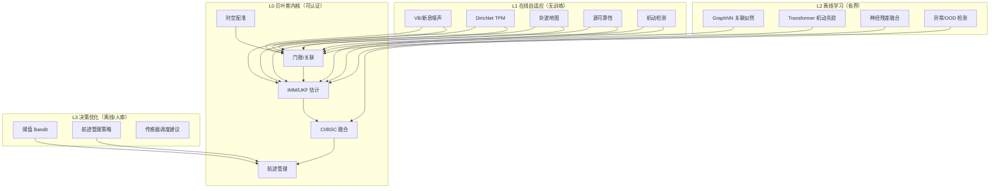
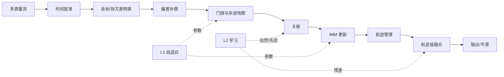
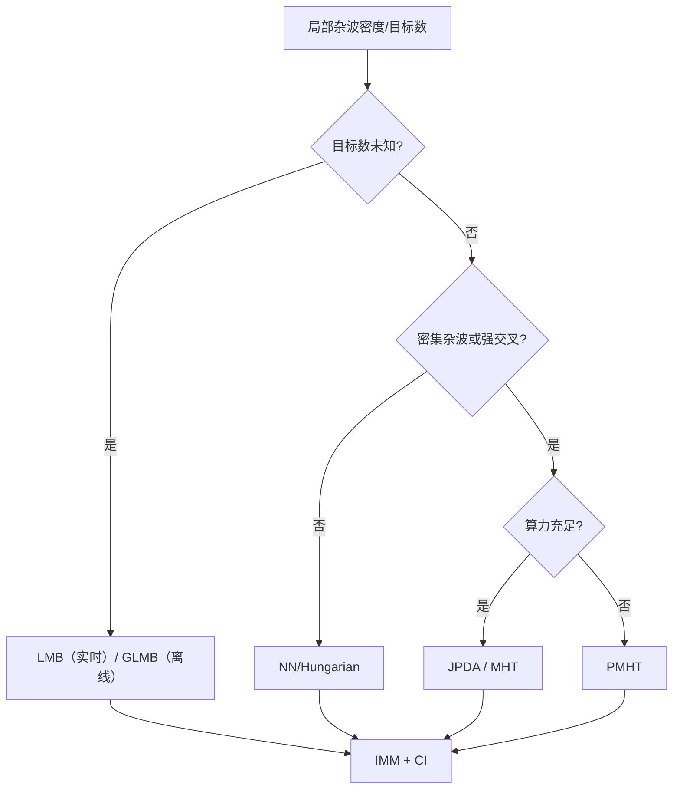

# 多源航迹融合核心算法设计（智能化增强版）

> 版本：1.0（算法评审稿）  
> 日期：2026-11-19  
> 范围：仅覆盖融合处理核心算法——时空配准、数据关联、状态估计、多源融合、航迹管理与智能增强；不涉及部署、接口与工程实现。  
> 关联文档：系统级设计见 [DESIGN.md](DESIGN.md)。

---

## 目录

1. [结论与推荐](#1-结论与推荐)
2. [问题建模](#2-问题建模)
3. [算法总体框架](#3-算法总体框架)
4. [时空配准算法](#4-时空配准算法)
5. [数据关联算法](#5-数据关联算法)
6. [状态估计算法](#6-状态估计算法)
7. [多源融合算法](#7-多源融合算法)
8. [航迹管理算法](#8-航迹管理算法)
9. [智能化算法体系](#9-智能化算法体系)
10. [算法对比与选型](#10-算法对比与选型)
11. [评估与验证](#11-评估与验证)
12. [风险与演进](#12-风险与演进)
13. [附录](#13-附录)

---

## 1. 结论与推荐

### 1.1 推荐算法栈

本方案推荐 **"可认证贝叶斯内核 + 在线统计自适应 + 离线学习增强 + 决策层优化"** 的四层算法体系，而不是用端到端深度学习替代融合内核。

主算法链：

```text
时空配准
  → 自适应门限 + 杂波地图
  → 关联（NN/Hungarian 基线；JPDA 常规；LMB/GLMB 或 PMHT 密集杂波）
  → IMM 估计（CV/CA/Singer；VB/新息自适应噪声；CT 扩展）
  → 融合（量测级序贯；航迹级 CI；离线因子图平滑）
  → 贝叶斯航迹管理（起批/确认/删除/去重）
```

### 1.2 五个核心结论

1. **内核必须是贝叶斯、可解释、可认证的**。关联、滤波、融合、航迹生命周期由概率模型驱动；任何学习模块只输出"似然、先验、残差、权重"，不直接决定航迹生死。
2. **关联算法按场景分档，不追求单一最优**。稀疏杂波用 NN/Hungarian；中等杂波用 JPDA；密集杂波且目标数未知用 LMB/GLMB；算力受限的密集场景用 PMHT。
3. **"智能"首先体现在自适应**。VB/新息自适应过程噪声、Dirichlet 转移概率学习、贝叶斯源可靠性、杂波地图、机动检测，这些不需要训练数据，却能在分布变化时保持一致性，是性价比最高的智能化。
4. **学习型算法只做"增强件"**。GraphNN 关联似然、Transformer 机动先验、神经残差融合，均以校准后的概率/有界残差接入，配 OOD 检测、一致性监控和一键回退。
5. **融合的相关性比融合公式更重要**。默认 CI 处理未知互相关；共享来源时禁止朴素融合；航迹级融合必须携带来源集合与血缘，否则精度提升是虚假的。

### 1.3 分阶段落地建议

| 阶段 | 算法内容 | 目标 |
|---|---|---|
| P0 基线 | 自适应门限 + NN/Hungarian + IMM(CV/CA/Singer) + CI + 贝叶斯航迹评分 | 可运行、可解释、可评估 |
| P1 自适应 | 新息自适应噪声 + Dirichlet TPM + 杂波地图 + 源可靠性 + 机动检测 | 分布变化下保持 NEES 一致 |
| P2 密集杂波 | JPDA 聚类；LMB/GLMB 或 PMHT；航迹间关联 | 交叉/编队/高杂波下 ID 稳定 |
| P3 学习增强 | GraphNN 关联似然、Transformer 机动先验、神经残差融合（影子模式） | 精度提升且可回退 |
| P4 平滑与复盘 | 滑窗因子图、OOSM 重放、离线精化 | 事后航迹质量与复盘能力 |

---

## 2. 问题建模

### 2.1 符号

| 符号 | 含义 |
|---|---|
| `x = [p, v, a]` | 九维目标状态：ENU 位置、速度、加速度 |
| `X_t = {x_1, ..., x_n}` | 目标随机有限集（数量未知） |
| `s ∈ S` | 传感器编号 |
| `Z_t^s = {z_1, ..., z_m}` | 传感器 `s` 在时刻 `t` 的量测集合 |
| `T` | 航迹数 |
| `M` | 单帧量测数 |
| `P_D` | 检测概率 |
| `λ(x)` | 杂波密度（单位体积） |
| `P_G` | 门限概率 |
| `A = [a_ij]` | 关联矩阵，`a_ij ∈ {0,1}` |
| `β_ij` | 量测 `j` 属于航迹 `i` 的边缘概率 |
| `μ_j` | IMM 第 `j` 个模型的后验概率 |
| `p_ij` | 模型 `i → j` 的马尔可夫转移概率 |

### 2.2 状态与量测模型

**运动模型**

```
x_{k+1} = F_j(Δt) x_k + w_k,    w_k ~ N(0, Q_j(Δt))
```

九维状态下的 CV/CA/Singer 模型见第 6 章；`j` 为模型编号。

**量测模型**

```
z_k = h_s(x_k) + b_s + v_k,      v_k ~ N(0, R_s)
```

- 位置量测（ADS-B、外部航迹）：`h(x) = Hx`，`H = [I_3 0_3 0_3]`。
- 极坐标量测（雷达）：`h(x) = [r, az, el]`：

```
r   = ||p - p_s||
az  = atan2(p_x - p_sx, p_y - p_sy)
el  = atan2(p_z - p_sz, sqrt((p_x-p_sx)² + (p_y-p_sy)²))
```

- 纯方位量测（ESM/IRST）：只含 `az, el`，距离不可观测。
- 传感器偏差 `b_s` 为待估计量（平移或距离/方位/俯仰偏差）。

### 2.3 核心难点

| 难点 | 表现 | 算法对策 |
|---|---|---|
| 关联不确定性 | 交叉、编队、密集杂波 | 门限 + JPDA/PMHT/GLMB；学习似然 |
| 目标数未知 | 新目标出现、旧目标消失 | 随机有限集（LMB/GLMB/PHD）；贝叶斯航迹评分 |
| 机动 | 模型失配、新息偏大 | IMM + 自适应噪声 + 机动检测 |
| 传感器偏差 | 系统性偏移、航迹分裂 | 增广状态/两阶段配准 |
| 异步与乱序 | 时间戳不一致、迟到量测 | 时间配准 + 固定滞后 + OOSM 重放 |
| 非线性 | 极坐标/纯方位 | EKF/UKF/CKF；粒子滤波 |
| 互相关 | 航迹级融合重复计数 | CI/BSC；来源集合；血缘 |
| 分布漂移 | 杂波、探测率、目标行为变化 | 在线自适应；学习模块影子运行 |

### 2.4 设计约束

- **可解释**：每条航迹的关联概率、模型概率、来源、质量可追溯。
- **可认证**：核心链路不依赖不可解释的黑箱；学习模块有边界与回退。
- **实时**：单节点 1000 航迹、200 量测/帧、10 Hz 的算力预算内。
- **稳健**：单传感器异常、单帧异常不导致全局失稳。

---

## 3. 算法总体框架

### 3.1 四层智能



**分层原则**

- L0 输出确定性的状态、协方差、关联概率；可单独运行、可单独验收。
- L1 只调整 L0 的参数，所有参数有上下界与变化率限制。
- L2 只提供似然/先验/残差，必须校准、可回退；默认影子模式。
- L3 只做离线策略优化或人工建议，不在生产环境在线探索。

### 3.2 算法流水线



### 3.3 处理顺序

1. 按事件时间排序，固定滞后重排。
2. 对每帧量测：时间/坐标/偏差校正。
3. 预测所有航迹到量测时刻。
4. 门限 + 聚类 + 关联。
5. 对匹配对做 IMM 更新；未匹配量测进入起批。
6. 航迹生命周期更新。
7. 航迹级融合（外部航迹）。
8. 质量评分、证据输出。
9. 可选：滑窗因子图平滑。

---

## 4. 时空配准算法

### 4.1 时间配准

**模型**

```
t_true = t_s + δ_s + ε_s,    ε_s ~ N(0, σ_t²)
```

`δ_s` 为传感器时钟偏移与传输时延之和。

**两级估计**

1. **粗配准**：PTP/NTP 提供 `δ_s` 初值；无硬件时间戳时用"到达时间 − 配置时延"。
2. **精配准**：利用已关联量测的残差随时间的相关性，估计残余时延：

```
δ̂_s = argmin_δ Σ_j ρ( || z_j - H x_i(t_j + δ) ||²_{S_j^-1} )
```

- `ρ` 为 Huber 损失，抑制关联错误。
- 一维搜索（黄金分割）或 Newton 迭代；步长限制 ±200 ms。
- 只在关联稳定、目标非机动的样本上估计；样本数 ≥ 30 才更新。
- 估计值限幅（如 ±500 ms），超过则判定时钟异常并隔离该源。

**设计要点**

- 时间配准误差直接转化为位置误差（`v·δ`）；300 m/s × 50 ms = 15 m，不能忽略。
- 对高动态目标，时间误差还会导致协方差失配，需在 `R` 中显式加入 `v²σ_t²` 项。

### 4.2 坐标与协方差转换

**统一坐标**：WGS84 → ECEF → ENU；量测先转到融合中心 ENU。

**极坐标转直角坐标**

```
p = p_s + [r cos(el) sin(az), r cos(el) cos(az), r sin(el)]
J = ∂p/∂(r, az, el)
R_cart = J diag(σ_r², σ_az², σ_el²) J'
```

- 一阶转换在角度误差大、距离近时有偏；近距离高精度场景建议直接用 EKF 在极坐标域更新（见 6.5）。
- 转换后强制对称、正定；条件数 > 1e12 时拒绝。

### 4.3 传感器偏差估计

**模型**

```
z_s = h_s(x) + b_s + v_s
```

**两种实现**

1. **增广状态滤波**：把 `b_s` 加入状态，随机游走建模：

```
b_{k+1} = b_k + w_b,   w_b ~ N(0, Q_b)
```

联合估计 `[x, b]`。优点是实时；缺点是可观性差，目标机动时偏差与状态耦合。

2. **两阶段批估计**（推荐）：

- 用当前偏差补偿量测，完成关联。
- 收集关联残差 `(z_s - h_s(x̂))`。
- 对平移偏差：鲁棒均值（Huber/截尾）。
- 对极坐标偏差：Gauss-Newton 最小化笛卡尔残差：

```
min_{Δr, Δaz, Δel} Σ ρ( || z_s + Δb - h_s(x̂) ||² )
```

**可观性与稳健性**

- 单目标匀速直线时，平移偏差与目标状态部分不可分辨；需要多目标、多方位或已知参考点。
- 只在残差改善 ≥ 15%、样本 ≥ 50 时启用新偏差；限幅 500 m；每 30 s 最多更新一次。
- 对机动目标降权；对关联置信度低的样本剔除。

### 4.4 量测可信度与野值抑制

- 质量分 `q ∈ [0,1]`：由 CRC、地址校验、信噪比、NIS 历史共同决定。
- 野值：新息马氏距离超过 `χ²_d(0.999)` 且连续 2 次，标记可疑；不直接删除，降权并等待二次确认。
- 协方差膨胀：`R_eff = R / q`，低质量量测自然降权。
- 物理包线：速度、高度、加速度越界直接拒绝并计数。

---

## 5. 数据关联算法

> 本节给出关联算法的全景与选型；智能关联算法 AGPA（图打分 + 概率分配 + 几何兜底）的完整设计见 [INTELLIGENT_ASSOCIATION.md](INTELLIGENT_ASSOCIATION.md)。

### 5.1 自适应门限

**基础门限**

```
ν_ij = z_j - H x_i
S_ij = H P_i H' + R_j
d²_ij = ν_ij' S_ij^-1 ν_ij
γ_ij = χ²_d(1 - P_G) · κ_clutter · κ_quality · κ_maneuver
```

- `d = 3`，`P_G = 0.999` → `χ² ≈ 16.27`。
- `κ_clutter = 1 + α·tanh(λ̂(x)/λ_0)`，杂波越密门限越大。
- `κ_quality = 1 + β(1 - q_i)`，航迹质量越低门限越宽。
- `κ_maneuver = 1 + γ·m_i`，机动强度越大门限越宽。
- 总门限限制在 `[0.7, 2.0] × γ_0`，防止无限放大。

**杂波地图**

- 将监视区划分为 3D 网格（如 5 km × 5 km × 1 km），每格维护杂波密度 `λ̂`。
- 用门内未关联量测数 / 门体积更新，EWMA 平滑。
- 冷启动用全局密度；每格样本数 < 30 时向全局收缩（层次贝叶斯）：

```
λ̂_cell = (n_cell + κ λ_global) / (V_cell + κ)
```

- 也可用 k-NN 或 Dirichlet 过程混合估计空间密度，适合非均匀杂波。

### 5.2 NN/Hungarian 基线

将航迹与量测的全局最近邻（Nearest Neighbor, NN）分配与匈牙利算法结合，作为可解释、低算力的基线。

**代价矩阵**

```
c_ij = d²_ij + ln det(S_ij) - 2 ln P_D + 2 ln λ̂(z_j)
```

- `ln det S` 惩罚大协方差航迹，避免"大门口"抢量测。
- `-ln P_D` 与 `ln λ` 来自负对数似然比，使代价具有概率意义。
- 门限外置 `+∞`。

**分配**

- 匈牙利算法 O(n³)，支持矩形矩阵与禁用边。
- 平局按 `(sensor_id, time, sequence)` 决胜，保证确定性。
- 输出关联对与未关联集合。

**适用**：杂波稀疏、目标间距 > 3σ、算力受限。

### 5.3 JPDA

**联合事件**

簇内 `T` 条航迹、`M` 个量测；事件 `θ` 为每条航迹分配"无检测"或一个未占用测量：

```
P(θ) ∝ Π_{i 关联} P_D · g_ij · Π_{i 未关联} (1-P_D) · λ^{M-|θ|}
g_ij = N(ν_ij; 0, S_ij)
```

**边缘概率**

```
β_ij = Σ_{θ: i→j} P(θ) / Σ_θ P(θ)
β_i0 = max(0, 1 - Σ_j β_ij)
```

**更新**

```
x_i = Σ_j β_ij x_ij + β_i0 x_i^-
P_i = Σ_j β_ij [P_ij + (x_ij - x_i)(x_ij - x_i)'] + β_i0 [P_i^- + (x_i^- - x_i)(x_i^- - x_i)']
```

**工程要点**

- 按门限图做连通分量，簇内独立枚举；大多数簇规模 ≤ 4。
- 精确枚举上限：`M ≤ 8`、`T ≤ 8`；超限退化为逐航迹独立 JPDA。
- 事件数硬上限（如 20,000）与超时保护，防止组合爆炸。
- 对 IMM：对每个模型分别计算更新，再用边缘概率混合（近似 JPDA-IMM）。

### 5.4 PMHT（概率多假设跟踪）

PMHT 用 EM 算法把关联当作隐变量，避免显式枚举联合事件，适合密集杂波与多传感器。

**E 步**（量测 `j` 属于航迹 `i` 的后验权重）：

```
w_ij = π_i g_ij / ( λ + Σ_k π_k g_kj )
g_ij = N(z_j; H x_i, S_i)
```

`π_i` 为航迹先验关联概率（可用航迹质量/检测率）。

**M 步**（加权更新）：

```
x_i = x_i^- + K_i Σ_j w_ij (z_j - H x_i^-)
```

严格形式是对加权似然做最大化，等价于把 `w_ij` 当作软关联做批量卡尔曼/平滑；多传感器时对每个传感器分别计算权重后合并。

**特点**

- 复杂度 `O(T·M·iter)`，无组合爆炸。
- 对密集杂波、邻近目标稳健；代价是收敛到局部最优、对初值敏感。
- 航迹管理需外置（PMHT 不直接处理起批/删除）。
- 多帧 PMHT 可做平滑，适合事后处理。

**建议**：作为 JPDA 与 GLMB 之间的"算力友好"选项；迭代 3–5 次，权重做温度缩放。

### 5.5 LMB/GLMB（标签随机有限集）

**动机**：目标数未知、需要航迹标签与连续性时，显式关联 + 固定航迹数会失效。

**GLMB 密度**

```
π(X) = Σ_{(I,ξ)} w^{(I,ξ)} δ_I(L(X)) [π^{(I,ξ)}]^X
```

- `I`：标签集合；`ξ`：关联历史；`w`：分量权重；`π`：单目标空间密度。
- 预测：存活标签 + 新生标签；权重乘生存/新生概率。
- 更新：对每个关联映射 `θ: I → {0,...,|Z|}`：

```
w^{(I,ξ,θ)} ∝ w^{(I,ξ)} Π_{i∈I} ψ_{θ(i)}(z_{θ(i)} | i)
```

其中 `ψ_0 = 1-P_D`，`ψ_j = P_D · p(z_j|x_i)/λ(z_j)`。

- 剪枝：按权重保留前 K 个分量、合并相似分量、限制单目标密度的高斯数。

**LMB 近似**

- 用"每个标签的存在概率 + 单目标密度"近似 GLMB，复杂度显著降低。
- 适合实时；精度略低于完整 GLMB。
- 标签保证 ID 连续，天然处理新生与死亡。
- **PHD/CPHD** 是未标注 RFS 的近似，只估计目标密度/数量，不保证标签连续性；适合"只关心有多少目标"的辅助场景，不作为航迹输出的主算法。

**建议**：高价值场景（密集杂波、编队、未知目标数）用 LMB；研究/离线用 GLMB；工程实现优先 LMB，保留 GLMB 接口。

### 5.6 学习型关联（GraphNN）

**图构建**

- 航迹节点 `i`：状态、协方差对角、速度、航迹年龄、质量、来源嵌入、历史编码。
- 量测节点 `j`：位置、协方差、传感器嵌入、时间差、属性（呼号/地址）。
- 边 `(i,j)`：马氏距离、`ln det S`、角度差、时间差、几何相容性。

**网络**

```
h_i^(0) = MLP(f_i),  h_j^(0) = MLP(f_j)
e_ij^(0) = MLP([f_i, f_j, e_ij])
for l in 1..L:
    h_i^(l) = Norm(h_i^(l-1) + Σ_j α_ij · V(h_j^(l-1), e_ij^(l-1)))
    e_ij^(l) = MLP([h_i^(l), h_j^(l), e_ij^(l-1)])
logit_ij = MLP([h_i^(L), h_j^(L), e_ij^(L)])
q_ij = sigmoid(logit_ij / T)
```

- `α_ij` 为注意力权重；`T` 为温度，用于校准。
- 增加"未关联"虚拟节点，学习门限外的拒识。
- 输出 `q_ij` 为校准后的关联概率。

**训练**

- 数据：仿真真值 + 实录人工复核；域随机化（杂波、偏差、机动、丢包、时间抖动）。
- 损失：逐边 BCE + 匈牙利匹配损失 + 熵正则；难负样本（交叉、编队）过采样。
- 校准：温度缩放/等渗回归；验证集 ECE < 0.05。
- 泛化：传感器嵌入、排列不变、变长图；留出场景族做跨域测试。

**集成方式**（三选一，推荐 A）

A. **代价融合**：`c_ij = -ln q_ij + w_g · d²_ij`，保留几何项，防止网络在 OOD 时乱配。
B. **JPDA 先验**：`β ∝ q_ij^α · N(ν;0,S)`，`α ≤ 0.5`，网络只做软提示。
C. **候选剪枝**：用 `q_ij` 过滤低概率边，再交给 Hungarian/JPDA。

**失效保护**

- OOD 检测：输入分布漂移（马氏距离、能量分数）超阈值 → 退回纯几何代价。
- 一致性：网络输出的关联概率与几何门限冲突时，以几何门限为准。
- 影子模式：先只记录不生效，对比基线关联正确率。

### 5.7 航迹间关联（T2T）

**几何检验**

```
ν = x_a - x_b
S = P_a + P_b - P_ab - P_ab'
d² = ν' S^-1 ν ≤ γ_T2T
```

- `P_ab` 未知时，用 `P_a + P_b` 并放宽门限，或用 CI 检验：

```
S_CI(ω) = P_a/ω + P_b/(1-ω)
```

- `S` 可能非正定（互相关估计误差），需做 Cholesky 校验/对角抖动；失败则退回 CI 检验。

- 属性辅助：分类、呼号、地址码、运动模式；用贝叶斯因子融合。

**学习型 T2T**

- 输入两航迹的历史、协方差、来源、属性；输出匹配概率。
- 训练数据来自同一目标的多节点航迹对（正样本）与邻近目标对（负样本）。
- 只作为几何检验的先验/补充，不单独决定匹配。

### 5.8 MHT（参考）

- **假设树**：每个节点表示"某航迹与某组量测"的对应；全局假设由各航迹的局部假设组合而成。
- **分数**：关联分支累加 `L = ln(P_D/(1-P_D)) + ln(g_ij/λ)`，未关联分支累加 `ln(1-P_D)`。
- **剪枝**：N-scan（保留最近 N 帧分叉）、分数比剪枝（`L < L_max - Δ`）、K-best 全局假设、航迹数上限。
- **输出**：最大后验全局假设；延迟 N 帧确认，期间保留多条候选。
- **优点**：高杂波、遮挡、交叉场景下关联正确率高；**缺点**：计算与实现复杂、参数敏感、延迟确认。
- **工程建议**：仅重点扇区或离线复盘开启；实时默认 LMB/JPDA，MHT 作为对照与后备。

### 5.9 关联算法切换策略

| 场景 | 推荐关联 | 理由 |
|---|---|---|
| 稀疏杂波、目标间距大 | NN/Hungarian | 快、可解释、易调参 |
| 中等杂波、目标数已知 | JPDA | 概率处理关联不确定性 |
| 密集杂波、算力受限 | PMHT | 无组合爆炸，软关联 |
| 密集杂波、目标数未知 | LMB（GLMB 离线） | 标签连续、自动起批/删批 |
| 强机动/交叉 | JPDA + IMM + 自适应门限 | 机动模型与关联联动 |
| 跨节点航迹 | CI 检验 + 学习型 T2T | 互相关未知，需保守 |

**运行时切换**：按局部杂波密度、簇规模、航迹数、CPU 水位选择；切换有滞回，避免抖动。

---

## 6. 状态估计算法

### 6.1 运动模型集

| 模型 | 转移 | 过程噪声 | 适用 |
|---|---|---|---|
| CV | 位置 `p+vΔt`，加速度置零 | 加速度白噪声 `q_a` | 巡航 |
| CA | 位置含 `½aΔt²`，加速度保持 | 加加速度白噪声 `q_j` | 匀加速 |
| Singer | 加速度按 `exp(-Δt/τ)` 衰减 | 相关噪声，稳态方差 `σ_a²` | 空中机动 |
| CT（扩展） | 协调转弯，角速度 `Ω` | 角速度随机游走 | 持续盘旋 |

**九维统一状态**：`[p, v, a]`，CV/CA/Singer 共享；CT 需要 `Ω`，建议作为第 10 维的扩展模型，IMM 混合时对 `Ω` 做零填充/投影，或单独用 CT-EKF 跟踪高机动目标。

### 6.2 IMM

**混合**

```
c_j = Σ_i p_ij μ_i
w_{i|j} = p_ij μ_i / c_j
x0_j = Σ_i w_{i|j} x_i
P0_j = Σ_i w_{i|j} [P_i + (x_i - x0_j)(x_i - x0_j)']
```

**预测**

```
x_j^- = F_j(Δt) x0_j
P_j^- = F_j P0_j F_j' + Q_j(Δt) · s_q
```

**更新与模型概率**

```
L_j = N(ν_j; 0, S_j)
μ_j^+ = L_j c_j / Σ_k L_k c_k
```

**输出**

```
x = Σ_j μ_j x_j
P = Σ_j μ_j [P_j + (x_j - x)(x_j - x)']
```

**工程细节**

- 对数域计算似然，`log-sum-exp` 归一。
- 模型概率下限 `1e-4`，防止"饿死"。
- 更新失败的模型似然置 `-∞`，不拖垮整条航迹。
- CV 的 `F` 奇异，禁止求逆；OOSM 用历史正向预测。

### 6.3 自适应噪声

#### 6.3.1 有界新息自适应（工程首选）

```
r_k = ν' S^-1 ν / d
s_q(k) = clamp( s_q(k-1) · exp(α (r_k - 1)), s_min, s_max )
```

- `r_k ≈ 1`：一致；`r_k > 1`：模型失配/机动，增大噪声。
- `α = 0.05`，`s_q ∈ [0.5, 4.0]`，每帧变化 ≤ 10%。
- 与机动检测取最大值，避免双重放大。

#### 6.3.2 VB 自适应量测噪声

未知 `R` 时，用逆 Wishart 先验：

```
R ~ IW(Ψ, ν_0)
ν_k = ν_{k-1} + 1
Ψ_k = γ Ψ_{k-1} + δ δ' + H P^- H'
R̂_k = Ψ_k / (ν_k - d - 1)
```

其中 `δ = z - H x^-` 为新息，`ν_0` 为先验自由度。

- `γ ∈ (0,1]` 为遗忘因子，跟踪非平稳噪声。
- 只在 `ν_k > d + 2` 时启用；否则用名义 `R`。
- 与质量分 `q` 结合：`R_eff = R̂ / q`。

#### 6.3.3 VB 自适应过程噪声

对每个模型的过程噪声尺度 `q_j` 设逆 Gamma 先验：

```
q_j ~ IG(a_j, b_j)
```

用变分下界更新 `a_j, b_j`，以归一化新息与预测协方差为充分统计量；工程上可退化为：

```
q̂_j ← clamp( q̂_j · (1 + η (r_j - 1)), q_min, q_max )
```

- 完整 VB 适合研究/离线；在线用有界更新，保证稳定性。
- 过程噪声与量测噪声不同时自适应，避免不可辨识；先固定 `R`，再调 `Q`。

### 6.4 Dirichlet 转移概率学习

IMM 的 `p_ij` 常为手工设定，分布变化时会失配。用 Dirichlet 先验在线学习：

```
p_i ~ Dirichlet(α_i1, ..., α_iK)
α_ij ← γ α_ij + μ_i(k) · p_ij(k)
p_ij = α_ij / Σ_k α_ik
```

- 软计数：用模型后验概率而非硬判决。
- 遗忘因子 `γ ∈ [0.99, 0.999]`，跟踪非平稳。
- 约束：`p_ii ≥ 0.5`，避免模型频繁跳变；变化率限制。

### 6.5 非线性滤波

| 场景 | 方法 | 说明 |
|---|---|---|
| 极坐标雷达 | EKF | 直接在极坐标域更新，避免转换偏差 |
| 纯方位 | UKF/CKF | 距离不可观测，需平台机动/多站 |
| 强非线性/多峰 | 粒子滤波 | 计算量大，用于重点目标 |
| 高维/高实时 | 避免粒子滤波 | 用 UKF/CKF 或 Rao-Blackwellized 分解 |

**EKF 极坐标更新**

```
H = ∂h/∂x
S = H P H' + R_polar
K = P H' S^-1
```

方位残差 wrap 到 `(-π, π]`；仰角在低仰角/远距离时观测性弱，`R` 放大。

**UKF 要点**

- Sigma 点对称采样，权重 `W_m, W_c`。
- 协方差非正定时加抖动或退回 EKF。
- 纯方位距离不可观测，需显式建模"距离先验"或等待机动。

### 6.6 机动检测与学习先验

**统计检测**

1. `μ_max < 0.6` 持续 3 帧。
2. `EWMA(NIS/d)` > 2.0。
3. `||a|| > 3σ_a` 持续 2 帧。

响应：增大 `s_q`、放宽门限、提高 Singer 模型先验；机动结束后指数回落。

**学习先验（可选）**

- 模型：Transformer/LSTM 编码最近 2–5 s 的轨迹、协方差、来源，输出未来加速度/转弯率的混合高斯分布。
- 用法：
  - 作为额外 IMM 模型（"学习模型"）的转移先验；
  - 或调节 `Q` 的方向/尺度（各向异性噪声）；
  - 或作为机动检测的辅助证据。
- 约束：输出限幅（加速度 ≤ 50 m/s²、角速度 ≤ 30°/s）、校准（NLL/CRPS 评估）、OOD 回退。
- 训练：仿真 + 实录；预测未来 1–3 s；与 IMM 基线做消融。

### 6.7 乱序量测（OOSM）

**固定滞后**：500 ms 内的乱序在缓冲层解决。

**历史回退**：

- 每条航迹保留 2 s、20 Hz 的状态与关联量测。
- 迟到量测 `t_τ`：取不晚于 `t_τ` 的最近历史，正向预测到 `t_τ`，更新。
- 从 `t_τ` 到当前，按历史量测重放。
- 超窗拒绝并计数。

**注意**：CV 的 `F` 奇异，不能反向外推；用"最近历史 + 正向预测"。

---

## 7. 多源融合算法

### 7.1 量测级融合

- 同一航迹按时间顺序依次更新多传感器量测，线性高斯下与顺序无关。
- 同一时刻多量测：按 `R` 小者先，或序贯更新。
- 重复点迹先做凝聚（距离/方位聚类），避免同一目标多次计入。
- 优点：信息无损；缺点：依赖配准与时间对齐。

### 7.2 航迹级融合

**CI（默认）**

```
P_ci^-1 = ω P_a^-1 + (1-ω) P_b^-1
x_ci = P_ci (ω P_a^-1 x_a + (1-ω) P_b^-1 x_b)
ω* = argmin_ω trace(P_ci(ω))
```

- 一维搜索（0.01 步长或黄金分割），限制 `ω ∈ [0.05, 0.95]`。
- 不需要互相关；结果是保守的（不小于真实误差协方差）。

**BSC（已知互相关）**

```
S = P_a + P_b - P_ab - P_ab'
K = P_a S^-1
x = x_a + K(x_b - x_a)
P = P_a - K S K'
```

- `P_ab` 可由共同过程噪声/先验推导；工程上难以精确，默认不用。
- `S` 需正定校验；失败则退回 CI。

**GRV/朴素融合（仅独立）**

```
P^-1 = P_a^-1 + P_b^-1
x = P(P_a^-1 x_a + P_b^-1 x_b)
```

- 仅当两航迹无共同量测、无共同过程噪声时使用；共享来源时禁用。

**加权 CI**

```
P^-1 = Σ_s w_s P_s^-1 / Σ_s w_s
```

`w_s` 由质量、一致性、新鲜度组成；归一化后使用。

### 7.3 RFS 密度融合

多传感器 PHD/LMB 的融合可用**加权几何平均**：

```
π_ω(x) ∝ Π_s [π_s(x)]^{ω_s},   Σ_s ω_s = 1
```

- 高斯混合的几何平均仍是高斯混合（高斯乘积），权重按指数加权。
- 假设传感器独立；相关时用 CI 形式近似。
- LMB 融合：融合存在概率与单目标密度，再归一化。
- 风险：重复计数、分量爆炸；需分量合并与剪枝。

**建议**：仅在密集多传感器、目标数未知且实现 LMB/GLMB 时使用；常规场景量测级融合更简单可靠。

### 7.4 因子图平滑（离线/滑窗）

**变量与因子**

- 变量：各时刻目标状态 `x_k`、关联变量 `a_k`、航迹标签。
- 关联变量通过 EM/多假设边缘化处理，或在外层用 JPDA/LMB 提供初值后再平滑。
- 因子：
  - 运动：`||x_{k+1} - F x_k||²_{Q^-1}`
  - 量测：`ρ(||z_k - h(x_k)||²_{R^-1})`
  - 航迹间：`||x_a - x_b||²_{(P_a+P_b)^-1}`；互相关未知时改用 CI 因子或放宽权重。
  - 起批/死亡：二值先验。

**求解**

```
x* = argmin_x Σ 因子残差²
```

- 高斯-牛顿/Levenberg-Marquardt；鲁棒核（Huber/Cauchy）抑制野值。
- 滑窗 2–5 s；边缘协方差用 Schur 补。
- 增量平滑（iSAM2 思路）用于实时滑窗。

**价值**：天然处理 OOSM、多源异步、航迹级融合；输出平滑轨迹与一致协方差。代价是延迟与实现复杂度，适合离线复盘/事后精化。

### 7.5 神经残差融合（研究增强）

**思路**：以 CI 为基线，学习有界残差与协方差修正。

```
x_fused = x_ci + Δx,   ||Δx|| ≤ κ · sqrt(trace(P_ci))
P_fused = P_ci · exp(δ),   δ ∈ [ln 0.8, ln 1.2]
```

- 输入：各源 `(x_s, P_s)`、来源嵌入、时间差、历史、互相关代理特征。
- 输出：`Δx`、`δ`；用 Gaussian NLL + 一致性惩罚训练。
- 约束：不能让协方差低于 CI 太多；NEES 监控；OOD 回退 CI。
- 现状：研究性强，缺少公开数据与认证方法；建议只在影子模式验证，不进入主链路。

### 7.6 相关性与重复计数

- 每条航迹维护 `source_set` 与 `lineage`。
- 来源交集非空 → 只允许 CI，不允许朴素/BSC。
- 跨节点传递来源摘要（哈希/布隆过滤器）。
- 融合前后 NEES 检查；持续过自信 → 提高过程噪声/退回 CI。

---

## 8. 航迹管理算法

### 8.1 贝叶斯起批与确认

**航迹评分（SPRT 形式）**

```
L_k = L_{k-1} + ln[ P_D · p(z_k|x) / λ(z_k) ]        (关联)
L_k = L_{k-1} + ln(1 - P_D)                          (未关联)
```

- 起批：连续 `M/N` 次关联成功（默认 2/3，按量测机会计数）。
- 确认：`L_k > ln(β/(1-β))`，默认 `β = 0.9`，或 hits ≥ 4 且质量达标。
- 删除：`L_k < ln(β_d/(1-β_d))` 或外推超时。

**速度初始化**：两点差分：

```
v = (z_2 - z_1)/(t_2 - t_1)
P_vv = (R_1 + R_2)/Δt² + q_a Δt
```

### 8.2 标签与连续性

- GLMB/LMB 用标签 `ℓ` 保证 ID 连续；新生目标分配新标签，死亡标签进入墓碑。
- 非 RFS 方案用航迹 ID + 别名表；合并保留较老 ID。
- 标签切换率纳入评估（ID switch）。

### 8.3 去重与合并

- 条件：位置马氏距离 ≤ 门限、速度差 ≤ 30 m/s、时间差 ≤ 1 s、连续 K 帧。
- 合并：CI 融合状态；来源并集；保留较老 ID；新 ID 进别名。
- 防误合并：来源完全不相交且质量差异大时，先降级观察。

### 8.4 智能参数调节（L3）

- 用上下文 Bandit/离线 RL 调确认/删除阈值、门限缩放、融合权重。
- 奖励：`-GOSPA - w_id·ID_switch - w_lat·latency`。
- 只在离线仿真/影子环境训练；生产用固定策略 + 人工审批。
- 安全护栏：参数边界、变化率限制、A/B 对照、一键回退。

---

## 9. 智能化算法体系

### 9.1 智能分级

| 层级 | 能力 | 训练需求 | 可解释性 | 认证风险 | 建议 |
|---|---|---|---|---|---|
| L0 贝叶斯内核 | 关联/滤波/融合/管理 | 无 | 高 | 低 | 必选 |
| L1 在线自适应 | 噪声/TPM/杂波/源可靠性 | 无 | 高 | 低 | 必选 |
| L2 学习增强 | GraphNN 关联/机动先验/残差融合 | 高 | 中 | 中高 | 可选，影子先行 |
| L3 决策优化 | 阈值/策略调优 | 中 | 中 | 中 | 离线/人审 |

### 9.2 在线自适应（无需训练）

- 新息自适应过程噪声（6.3.1）。
- VB 量测噪声（6.3.2）。
- Dirichlet TPM（6.4）。
- 杂波地图（5.1）。
- 贝叶斯源可靠性：Beta-Bernoulli 检测率 + 逆 Gamma NIS 一致性。
- 机动检测（6.6）。
- 偏差估计（4.3）。

**共同约束**：参数边界、变化率限制、可观性检查、异常冻结。

**贝叶斯源可靠性（示例）**

```
p_d,s ~ Beta(a_s, b_s)
a_s ← a_s + 1[该源量测被关联]
b_s ← b_s + 1[该源量测未被关联]
c_s = 1 / (1 + max(0, EWMA(NIS/d) - 1))
w_s ∝ (a_s/(a_s+b_s))^γ · c_s^δ · exp(-Δt/τ)
```

- 检测率用 Beta-Bernoulli 共轭更新；一致性用 NIS 的逆 Gamma/EWMA 估计。
- 权重经归一化后用于关联源惩罚与融合权重；单源权重 < 0.05 时剔除。

### 9.3 离线学习（有界增强）

| 模块 | 输出 | 接入点 | 训练数据 | 失败回退 |
|---|---|---|---|---|
| GraphNN 关联 | 边概率 `q_ij` | 代价/JPDA 先验 | 仿真 + 复核实录 | 纯几何代价 |
| Transformer 机动先验 | 加速度/角速度分布 | IMM 先验/`Q` | 轨迹数据 | 标称 IMM |
| 神经残差融合 | `Δx, δ` | CI 输出 | 多源仿真 | CI |
| VAE/能量 OOD | OOD 分数 | 各模块入口 | 正常分布 | 保守参数 |

### 9.4 可解释性与安全护栏

- **校准**：所有学习输出必须校准（ECE < 0.05）；未校准概率不得进入贝叶斯更新。
- **有界**：残差、噪声、门限、权重均有上下界。
- **一致**：NEES/NIS 监控；CI 保守性检查；关联概率与几何门限冲突时几何优先。
- **可回退**：每个学习模块有开关与基线路径；影子模式至少 7 天。
- **可解释**：输出 top-3 特征贡献、模型版本、训练数据哈希。
- **OOD**：输入漂移检测；超阈值退回规则。
- **不确定性**：学习模块同时输出均值与方差（集成/MC dropout/异方差头），方差用于门限与融合权重，不把点估计当确定值。
- **对抗**：ADS-B 欺骗、量测注入；异常检测 + 源隔离 + 人工确认。

### 9.5 数据与训练

- **仿真先行**：域随机化（杂波、偏差、机动、丢包、时延、传感器布局），生成带真值的大规模数据。
- **实录补充**：高置信航迹自动标注 + 人工抽检；主动学习挑难例。
- **难负样本**：交叉、编队、近距离平行、机动。
- **数据隔离**：训练/验证/测试按场景族划分，避免同场景泄漏。
- **漂移监控**：特征 PSI、关联概率分布、NEES 趋势；漂移超阈值回退。

---

## 10. 算法对比与选型

### 10.1 对比

| 算法 | 目标数未知 | 密集杂波 | ID 连续 | 计算量 | 数据需求 | 可解释 | 认证风险 |
|---|---|---|---|---|---|---|---|
| NN/Hungarian | 否 | 低 | 中 | 低 | 无 | 高 | 低 |
| JPDA | 否 | 中高 | 中 | 中 | 无 | 高 | 低 |
| PMHT | 否 | 高 | 中 | 中低 | 无 | 中 | 低中 |
| MHT | 否 | 高 | 高 | 高 | 无 | 中 | 中 |
| LMB | 是 | 高 | 高 | 中高 | 无 | 中高 | 中 |
| GLMB | 是 | 很高 | 很高 | 高 | 无 | 中 | 中高 |
| 因子图平滑 | 是* | 高 | 高 | 高 | 无 | 高 | 中 |
| GraphNN 学习关联 | 否 | 学习 | 中 | 中 | 高 | 低中 | 中高 |
| 神经残差融合 | 继承前端 | — | — | 低 | 很高 | 低 | 高 |

\* 因子图需显式建模起批/死亡。

### 10.2 场景选型

| 场景 | 关联 | 估计 | 融合 |
|---|---|---|---|
| 稀疏空域、常规巡逻 | NN/Hungarian | IMM | 量测级 + CI |
| 城市低空、杂波多 | JPDA + 杂波地图 | IMM + 自适应噪声 | 量测级 + CI |
| 编队/交叉、目标数未知 | LMB | IMM + 标签 | 量测级 + CI |
| 强机动/高动态 | JPDA/PMHT | IMM + CT + 学习先验 | CI |
| 跨节点航迹融合 | T2T + 学习相似度 | 各自 IMM | CI + 因子图离线 |
| 算力受限的密集场景 | PMHT | IMM | CI |
| 事后复盘/精化 | 全局关联 | 因子图平滑 | 因子图 |

**选型决策树**



### 10.3 推荐组合

**主方案（工程可落地）**

```
门限（自适应）+ NN/Hungarian
+ IMM(CV/CA/Singer) + 有界新息自适应
+ 量测级融合 + CI（跨节点）
+ 贝叶斯航迹评分
```

**增强方案（高价值场景）**

```
JPDA/LMB（密集杂波/未知目标数）
+ VB/新息自适应 + Dirichlet TPM
+ 学习型关联似然（影子→灰度）
+ 因子图滑窗平滑（离线/事后）
```

**研究方案（不进入主链路）**

```
GLMB + 学习机动先验 + 神经残差融合
```

### 10.4 复杂度

| 模块 | 复杂度 | 1000 轨/200 量测/10 Hz |
|---|---|---|
| 门限 | `O(T·M)` | ~2×10⁵ 次距离/帧 |
| Hungarian | `O(max(T,M)³)` | 8×10⁶ 次/帧 |
| JPDA | 指数（簇内） | 簇 ≤ 4 时可控 |
| PMHT | `O(T·M·iter)` | ~6×10⁵ 次/帧（3 iter） |
| LMB | `O(T·M·K)` | 取决于分量数 K |
| IMM | `O(T·K·d³)` | ~3×10⁴ 次/帧 |
| CI | `O(T_pair·d³·search)` | 跨节点少量航迹 |

---

## 11. 评估与验证

### 11.1 指标

| 指标 | 定义 | 用途 |
|---|---|---|
| GOSPA | 广义 OSPA，含基数惩罚 | 综合精度/基数 |
| 位置/速度 RMSE | 与真值误差 | 精度 |
| NEES | `e'P^-1e`，卡方检验 | 协方差一致性 |
| NIS | 新息归一化平方 | 滤波器一致性 |
| ID switch | 每目标每小时 ID 变更 | 连续性 |
| 航迹纯度 | 主目标量测占比 | 关联质量 |
| 关联 P/R | 正确关联的精确率/召回率 | 关联算法 |
| ECE | 学习概率校准误差 | 学习模块 |
| OOD AUROC | 分布外检测 | 安全性 |
| 时延 | 每帧处理时间 | 实时性 |

**GOSPA**（`α = 2` 标准形式）

```
GOSPA(X,Y) = [ min_θ ( Σ_{(i,j)∈θ} d(x_i,y_j)^p
              + (c^p/2)(|X| + |Y| - 2|θ|) ) ]^{1/p}
```

`θ` 为部分分配，`c` 为截止距离；`|X|` 为真值数，`|Y|` 为估计数。`α ≠ 2` 的广义形式见 GOSPA 原论文。

### 11.2 消融实验

- 基线：NN + IMM + CI。
- 加入自适应噪声；加入 Dirichlet TPM；加入杂波地图；加入 JPDA；加入 LMB；加入 GraphNN 关联；加入因子图。
- 每个模块单独开关，报告 GOSPA/ID/NEES 变化与算力代价。

### 11.3 压力测试

- 密集杂波（λ 提高 10×/100×）。
- 目标交叉/编队/近距离平行。
- 强机动（6–9 g 转弯、爬升）。
- 传感器失效/丢包/重复/乱序/时钟跳变。
- 偏差阶跃/漂移。
- ADS-B 欺骗/量测注入。
- 分布外目标（速度/高度/行为超出训练集）。

### 11.4 验收阈值（建议）

| 项 | 阈值 |
|---|---|
| 位置 RMSE | ≤ 50 m（雷达+ADS-B） |
| GOSPA | ≤ 60 m |
| 航迹连续率 | ≥ 99% |
| ID switch | ≤ 0.1 次/目标/小时 |
| 虚假航迹 | ≤ 0.5 条/小时 |
| NEES | 95% 落在卡方区间 |
| 关联召回 | ≥ 95%（稀疏杂波） |
| 关联精确 | ≥ 98%（稀疏杂波） |
| 学习模块 ECE | ≤ 0.05 |
| 内核时延 p95 | ≤ 50 ms |

---

## 12. 风险与演进

| 风险 | 影响 | 缓解 |
|---|---|---|
| 学习数据不足/仿真鸿沟 | 学习模块泛化差 | 域随机化、实录补充、影子验证、回退 |
| 分布漂移 | 关联/噪声失配 | 在线自适应、漂移监控、定期重训 |
| 过自信 | 协方差低估、错误融合 | NEES/NIS 监控、CI、保守下限 |
| 组合爆炸 | JPDA/GLMB 超时 | 簇分解、上限、PMHT 降级 |
| 标签错误 | ID 切换、航迹撕裂 | 标签 RFS、合并策略、人工复核 |
| 对抗欺骗 | 虚假航迹/错误关联 | 异常检测、源隔离、多源交叉验证 |
| 认证 | 学习模块难认证 | 核心保持贝叶斯；学习仅增强；可回退 |
| 参数过拟合 | 场景稍变即失效 | 参数边界、跨场景验证、自适应 |

**演进路线**

1. 基线：自适应门限 + NN/Hungarian + IMM + CI + 贝叶斯评分。
2. 自适应：新息/VB 噪声、Dirichlet TPM、杂波地图、源可靠性。
3. 密集杂波：JPDA → PMHT → LMB。
4. 学习增强：GraphNN 关联 → 机动先验 → 残差融合（影子模式）。
5. 平滑：滑窗因子图、OOSM 重放、离线精化。

---

## 13. 附录

### 13.1 IMM 伪代码

```text
function IMM_step(track, z, dt):
    # 1. 混合
    for j in models:
        c[j] = Σ_i p[i][j] * mu[i]
        for i in models:
            w[i][j] = p[i][j] * mu[i] / c[j]
        x0[j] = Σ_i w[i][j] * x[i]
        P0[j] = Σ_i w[i][j] * (P[i] + (x[i]-x0[j])(x[i]-x0[j])')
    # 2. 预测
    for j in models:
        x[j] = F[j](dt) * x0[j]
        P[j] = F[j] * P0[j] * F[j]' + Q[j](dt) * s_q
    # 3. 更新
    for j in models:
        (x[j], P[j], L[j]) = KalmanUpdate(x[j], P[j], z, R)
    # 4. 模型概率
    mu[j] = L[j] * c[j] / Σ_k L[k] * c[k]
    # 5. 输出
    x_out = Σ_j mu[j] * x[j]
    P_out = Σ_j mu[j] * (P[j] + (x[j]-x_out)(x[j]-x_out)')
    return (x_out, P_out, mu)
```

### 13.2 JPDA 伪代码

```text
function JPDA(tracks, measurements):
    clusters = connected_components(gate_graph(tracks, measurements))
    for cluster in clusters:
        events = enumerate_joint_events(cluster, cap=20000)
        total = Σ_events weight(event)
        for track i:
            beta[i][0] = Σ_{event: i unassigned} weight(event) / total
            for measurement j:
                beta[i][j] = Σ_{event: i->j} weight(event) / total
            (x[i], P[i]) = combine_updates(beta[i], measurements)
    return tracks
```

### 13.3 GLMB 更新要点

```text
for each component (I, xi, w):
    for each association map theta: I -> {0..M}:
        w_new = w * Π_i psi_theta(i)
        spatial_new = update_density(pi, theta)
        keep if w_new > prune_threshold
normalize weights
merge components with similar label sets
cap component count
```

### 13.4 GraphNN 关联特征

| 类别 | 特征 |
|---|---|
| 航迹节点 | 位置、速度、加速度、协方差对角、年龄、质量、来源 one-hot、历史编码 |
| 量测节点 | 位置、协方差、传感器嵌入、时间差、属性（呼号/地址） |
| 边 | 马氏距离、`ln det S`、角度差、时间差、门限标志 |
| 全局 | 杂波密度、目标数、传感器数 |

### 13.5 因子图目标函数

```
min_x Σ_k ||x_k - F x_{k-1}||²_{Q^-1}
    + Σ_k ρ(||z_k - h(x_k)||²_{R^-1})
    + Σ_{(a,b)} ||x_a - x_b||²_{(P_a+P_b)^-1}
    + Σ 起批/死亡先验
```

### 13.6 符号表

| 符号 | 含义 |
|---|---|
| `F, Q` | 状态转移、过程噪声 |
| `H, R` | 量测矩阵、量测噪声 |
| `ν, S` | 新息、新息协方差 |
| `β` | 关联边缘概率 |
| `μ` | 模型概率 |
| `λ` | 杂波密度 |
| `P_D` | 检测概率 |
| `γ` | 门限 |
| `ω` | CI 权重 |

### 13.7 参考

- GOSPA 指标与 `α = 2` 定义：[Probabilistic Trajectory GOSPA](https://ar5iv.labs.arxiv.org/html/2506.15148)
- Vo, B.-N. & Vo, B.-T., *Labeled Random Finite Sets and Multi-Object Conjugate Priors*, IEEE TSP, 2013.
- Streit, R. & Luginbuhl, T., *Probabilistic Multi-Hypothesis Tracking*, NUWC-NPT TR 10428, 1995.
- Julier, S. & Uhlmann, J., *A Non-divergent Estimation Algorithm in the Presence of Unknown Correlations*, ACC 1997.
- Bar-Shalom, Y., Willett, P. & Tian, X., *Tracking and Data Fusion: A Handbook of Algorithms*, 2011.

---

*本方案为算法设计基线。所有阈值、噪声、门限需在目标场景的仿真与实录数据上标定；学习模块必须先校准、再影子、后灰度，任何情况下都保留纯贝叶斯回退路径。*
