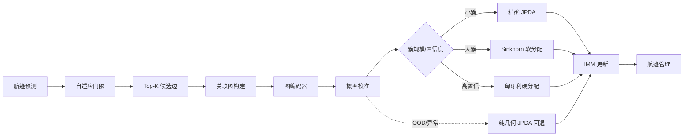

# AGPA：面向多源航迹融合的智能关联算法设计

> 版本：1.0（算法评审稿）  
> 日期：2026-11-19  
> 范围：量测—航迹关联（M2T）与航迹—航迹关联（T2T）共用的智能关联算法  
> 关联文档：[FUSION_ALGORITHMS.md](FUSION_ALGORITHMS.md)（融合算法全景）、[DESIGN.md](DESIGN.md)（系统设计）

---

## 目录

1. [摘要](#1-摘要)
2. [问题与设计目标](#2-问题与设计目标)
3. [算法总览](#3-算法总览)
4. [符号与概率模型](#4-符号与概率模型)
5. [阶段一：自适应候选生成](#5-阶段一自适应候选生成)
6. [阶段二：关联图构建](#6-阶段二关联图构建)
7. [阶段三：图编码器](#7-阶段三图编码器)
8. [阶段四：概率校准](#8-阶段四概率校准)
9. [阶段五：概率分配](#9-阶段五概率分配)
10. [阶段六：航迹间关联](#10-阶段六航迹间关联)
11. [训练方法](#11-训练方法)
12. [在线自适应与安全护栏](#12-在线自适应与安全护栏)
13. [复杂度与实时性](#13-复杂度与实时性)
14. [评估、消融与验收](#14-评估消融与验收)
15. [风险与落地路线](#15-风险与落地路线)
16. [附录](#16-附录)

---

## 1. 摘要

**AGPA（Adaptive Graph Probabilistic Association，自适应图概率关联）** 是一个面向多源多目标跟踪的智能关联算法。它把关联拆成三个可分别验证的部分：

1. **学习负责"像不像"**：用图注意力网络对"航迹—量测"（或"航迹—航迹"）的候选边打分，输入包含运动学残差、协方差、时间差、传感器特性、航迹历史与来源一致性。
2. **概率负责"怎么分"**：把网络输出校准成关联概率，转成似然比，与几何似然、检测概率、杂波密度一起构成分配得分；小簇用精确 JPDA，大簇用 Sinkhorn 软分配，置信度高时退化为匈牙利硬分配。
3. **几何负责"不许乱来"**：自适应 χ² 门限是硬约束；OOD、校准漂移、NEES 异常时自动回退到纯几何 JPDA。

一句话：**学习打分、概率分配、几何兜底**。

AGPA 同时覆盖两类关联：

- **M2T（量测—航迹）**：多传感器点迹到融合航迹的关联，是融合主链路。
- **T2T（航迹—航迹）**：本地航迹与外部节点/局部跟踪器航迹的关联，用于跨节点融合。

二者共用图编码器与分配器，只替换节点特征、边特征和得分项。

---

## 2. 问题与设计目标

### 2.1 输入与输出

**输入**

- 航迹集合 `T = {1..T}`：预测状态 `x_i`、协方差 `P_i`、质量 `κ_i`、来源集合 `src_i`、历史、IMM 模型概率。
- 量测集合 `M = {1..M}`：位置/极坐标/纯方位、协方差 `R_j`、传感器 `s_j`、时间 `t_j`、质量 `κ_j`、属性。
- 上下文：杂波地图 `λ̂(x)`、传感器可靠性、时间窗、平台/地理约束。

**分批方式**

关联以"传感器扫描/同一时间组"为单位执行：同一批内每个航迹最多匹配一个量测；不同传感器或不同时刻的量测按时间顺序分批处理。这样既保留一对一的分配约束，又允许一条航迹被多批量测先后更新（多传感器序贯融合）。同一时刻多传感器时，按传感器 ID 的确定性顺序分批。

**输出**

- 硬关联 `A = {(i,j)}`：一对一（或一对空）匹配。
- 软边际 `β_ij`、`β_i0`：供 JPDA/IMM 更新与航迹管理使用。
- 置信度 `conf_ij`、拒识标志、可解释证据（top 特征）。
- 未关联量测集合（进入起批候选）。

### 2.2 传统方法的结构性问题

| 方法 | 问题 |
|---|---|
| 最近邻 + 匈牙利 | 硬判决、无不确定性；交叉/杂波下易互换 |
| JPDA | 需要枚举联合事件；似然手工设计；杂波/检测概率假设强 |
| 图网络边分类 + 匈牙利 | 边独立打分，未显式建模一对约束；概率未校准 |
| 端到端 Transformer 跟踪 | 丢失协方差与几何约束；难认证、难回退、难解释 |

**关联方法对比**

| 方法 | 一对约束 | 软边际 | 关系学习 | 概率校准 | 数据需求 | 实时性 |
|---|---|---|---|---|---|---|
| NN + 匈牙利 | 硬约束 | 否 | 否 | 否 | 无 | 高 |
| JPDA | 是（枚举） | 是 | 否 | 概率语义 | 无 | 中 |
| MHT | 是（假设树） | 是 | 否 | 概率语义 | 无 | 低 |
| 图网络边分类 + 匈牙利 | 硬约束 | 否 | 是 | 常缺失 | 高 | 高 |
| **AGPA** | 是（JPDA/Sinkhorn） | 是 | 是 | 强制 | 高 | 中高 |

AGPA 的出发点：**保留 JPDA 的概率语义与几何门限，用学习改善"边"的质量，用集合级分配保证一对约束，用校准保证概率可进贝叶斯更新。**

端到端 Transformer 跟踪器把关联与状态估计耦合在一个黑箱里，输出通常没有协方差，难以与 IMM/CI/航迹管理对接，也难以解释"为什么这条边被选中"。AGPA 只学习边概率，状态估计、协方差与航迹生命周期仍由贝叶斯后端完成，因此可以逐步灰度、随时回退。

### 2.3 设计目标

| 目标 | 具体要求 |
|---|---|
| 精度 | 交叉、编队、密集杂波下关联正确率优于几何 JPDA |
| 不确定性 | 输出校准概率，ECE ≤ 0.05；可参与 JPDA 权重 |
| 实时 | 1000 航迹、200 量测/帧、10 Hz 下 ≤ 5 ms（CPU，批处理） |
| 可解释 | 每条边可输出 top-3 特征贡献与几何门限状态 |
| 可回退 | OOD/异常/未校准 → 纯几何 JPDA |
| 可认证 | 学习只影响似然，不直接删除/建立航迹 |

### 2.4 适用边界

- 适用于有监督或半监督数据的场景；无数据时先跑几何基线。
- 不适用于完全未知的传感器模态（无嵌入、无训练分布）；此时走回退。
- 不替代航迹管理；起批/删除仍由贝叶斯评分或 LMB 负责。目标数未知时，AGPA 只输出边际，不在关联器内决定航迹生死。

---

## 3. 算法总览

### 3.1 流水线



### 3.2 与现有算法的关系

- **对 JPDA**：AGPA 用学习到的边先验 `r_ij` 调制联合事件权重；当先验指数 `α = 0` 时严格退化为标准 JPDA。
- **对图网络边分类**：AGPA 不只做逐边二分类，还通过 Sinkhorn/JPDA 建模一对约束，并用集合级损失训练。
- **对匈牙利**：AGPA 在置信度高时才硬分配；否则保留软边际，避免过早锁定错误关联。
- **对 LMB/GLMB**：AGPA 的 `q_ij` 可作为标签 RFS 更新中关联映射的边权重（修正检测似然）；LMB 负责标签、新生与死亡，AGPA 负责"哪条边可信"，二者互补。

### 3.3 三个关键设计

1. **门限内学习**：网络只在几何门限内的候选边上工作，不能凭空创造关联。
2. **似然比而非概率直接相乘**：`q_ij` 转成 `r_ij = q/(1-q)`，以指数 `α` 进入 JPDA，避免先验过强。
3. **双模式分配**：小簇精确枚举，保证概率语义；大簇 Sinkhorn 近似，保证实时；高置信硬分配，保证输出稳定。

---

## 4. 符号与概率模型

### 4.1 符号

| 符号 | 含义 |
|---|---|
| `i` | 航迹索引 |
| `j` | 量测索引 |
| `x_i, P_i` | 航迹预测状态与协方差 |
| `z_j, R_j` | 量测与协方差 |
| `ν_ij, S_ij` | 新息与新息协方差 |
| `g_ij` | 几何似然 `N(ν_ij; 0, S_ij)` |
| `q_ij` | 网络输出的校准关联概率 |
| `r_ij` | 似然比 `q_ij/(1-q_ij)` |
| `α` | 学习先验指数，`0 ≤ α ≤ 1` |
| `P_D` | 检测概率 |
| `λ(z)` | 杂波密度 |
| `c_ij` | 分配得分 |
| `β_ij` | 关联边际概率 |
| `κ_i` | 航迹质量 |
| `τ` | 校准温度 |
| `τ_s` | Sinkhorn 分配温度 |
| `K` | 每航迹候选边上限 |

### 4.2 贝叶斯关联模型

标准 JPDA 的联合事件权重：

```
P(θ) ∝ Π_{i 关联} P_D · g_ij · Π_{i 未关联} (1 - P_D) · λ^{M - |θ|}
```

AGPA 引入学习先验的似然比：

```
P(θ) ∝ Π_{i 关联} P_D · g_ij · r_ij^α
        · Π_{i 未关联} (1 - P_D) · λ^{M - |θ|}
```

- `α = 0`：标准 JPDA，学习完全不生效。
- `α = 1`：网络先验与几何似然等权。
- 建议 `α ∈ [0.2, 0.6]`，按验证集选择；先验过强会放大网络误判。
- `q_ij` 在转 odds 前截断到 `[1e-6, 1-1e-6]`，避免数值爆炸。

**为什么用似然比**：`q_ij` 是"边为真"的概率，`r_ij = q/(1-q)` 是"真/假"的 odds；乘到事件权重上相当于对先验 odds 做温度化调整，语义比直接乘概率清晰。需要说明，`r_ij` 是判别式模型给出的似然比估计，不保证严格后验；因此用 `α` 限幅，并以校准、门限和回退约束其影响。

### 4.3 几何项

```
g_ij = (2π)^{-d/2} |S_ij|^{-1/2} exp(-0.5 ν_ij' S_ij^-1 ν_ij)
```

取对数：

```
ln g_ij = -0.5 (d ln 2π + ln|S_ij| + d²_ij)
```

门限：

```
d²_ij ≤ γ_ij = χ²_d(1-P_G) · κ_clutter · κ_quality · κ_maneuver
```

---

## 5. 阶段一：自适应候选生成

### 5.1 目的

把 `T × M` 的全连接降到 `E ≤ E_max`（默认 `8T`）的稀疏候选，既控制算力，也把"不可能"的边排除在学习之外。

### 5.2 自适应门限

```
d²_ij = ν_ij' S_ij^-1 ν_ij
γ_ij = χ²_d(1-P_G) · κ_clutter · κ_quality · κ_maneuver
```

- `P_G = 0.999`，`d = 3` → `γ_0 ≈ 16.27`。
- `κ_clutter = 1 + a·tanh(λ̂(x_j)/λ_0)`，杂波越密门限越宽。
- `κ_quality = 1 + b(1-κ_i)`，航迹质量越低门限越宽。
- `κ_maneuver = 1 + c·m_i`，机动强度越大门限越宽。
- 总缩放限制在 `[0.7, 2.0]`。

### 5.3 候选预算

对每条航迹：

1. 保留门限内的所有量测。
2. 按 `d²_ij + ln|S_ij|` 升序取前 `K` 个（默认 `K = 6`）。
3. 对每个量测，保留最近的 `K_m` 条航迹（默认 `K_m = 6`），取并集。
4. 总边数上限 `E_max`（如 `8·T`），超出按得分截断。

**为什么双向 Top-K**：只按航迹取 Top-K 会让"热门量测"被多条航迹争抢，双向并集能保留量测侧的最佳候选，同时控制规模。

### 5.4 时间与传感器约束

- 时间差 `|t_j - t_i|` 超过 `max_association_gap` 直接排除；默认取 `max(2 s, 2×传感器扫描周期)`，兼顾慢扫描雷达与 OOSM 窗口。
- 传感器—航迹兼容性：若航迹 `src_i` 已包含同一传感器同一扫描周期的点迹，降权或排除，避免重复计入。
- 纯方位量测只与已有航迹关联，不参与起批。

### 5.5 输出

候选边集合 `C = {(i,j)}`、每条边的几何量 `(ν_ij, S_ij, d²_ij, ln|S_ij|)`、门限标志。

---

## 6. 阶段二：关联图构建

### 6.1 图结构

二部图 `G = (V_t ∪ V_m, E)`：

- 航迹节点 `V_t`：每条航迹一个节点。
- 量测节点 `V_m`：每个量测一个节点。
- 边 `E`：候选边。
- 虚拟节点：一个"未关联"虚拟量测节点（供航迹选择）、一个"杂波"虚拟航迹节点（供量测选择）。

**T2T 变体**：两侧都是航迹节点，虚拟节点表示"不匹配"。

### 6.2 节点特征

| 特征 | 维度 | 说明 | 归一化 |
|---|---|---|---|
| 位置 | 3 | 相对融合中心的 ENU 米 | 按场景尺度 / 1000 |
| 速度 | 3 | m/s | / 300 |
| 加速度 | 3 | m/s² | / 10 |
| 协方差对角 | 9 | 位置/速度/加速度方差 | `log1p` |
| 航迹年龄 | 1 | s | / 60 |
| 质量 | 1 | [0,1] | 原值 |
| 最近 NIS | 1 | EWMA | / 10 |
| 模型概率 | 3 | IMM | 原值 |
| 来源嵌入 | 8 | 传感器集合的嵌入 | 学习 |
| 历史编码 | 16 | 最近 2 s 轨迹的 GRU/池化 | 学习 |
| 量测位置 | 3 | 相对融合中心的 ENU | / 1000 |
| 量测协方差对角 | 3 | `log` | `log1p` |
| 传感器嵌入 | 8 | 传感器 ID/类型 | 学习 |
| 时间差 | 1 | s | / 2 |
| 量测质量 | 1 | [0,1] | 原值 |
| 属性嵌入 | 8 | 呼号/地址/分类 | 学习 |

**缺失值**：用可学习的 mask token，不用 0 填充（0 会与真实值混淆）。

### 6.3 边特征

| 特征 | 维度 | 说明 |
|---|---|---|
| 马氏距离 `d²` | 1 | 几何相容性 |
| `ln|S|` | 1 | 门限体积 |
| 归一化新息 | 3 | `S^{-1/2}ν` |
| 角度差 | 2 | 方位/俯仰（wrap） |
| 时间差 | 1 | s |
| 门限比 | 1 | `d²/γ` |
| 同源同扫描 | 1 | 该量测与航迹上次更新是否同一传感器同一扫描周期 |
| 传感器可靠性 | 1 | `[0,1]` |
| 属性匹配 | 1 | 呼号/地址一致 |

### 6.4 为什么用图

- 关联本质是"关系"问题：目标交叉时，单看一条边无法区分，必须看邻近航迹与量测的相对几何。
- 图结构天然处理变长、变数量的输入，且对节点排列不变。
- 传感器嵌入让同一个模型适配多源异构传感器。

---

## 7. 阶段三：图编码器

### 7.1 结构

- 输入投影：航迹/量测/边分别过 MLP 到 `d = 32`（可配 64）。
- `L = 2` 层边感知注意力（Edge-Conditioned Attention）。
- 残差 + LayerNorm。
- 边分类头输出 logit。

### 7.2 单层更新

```
m_ij = MLP_msg([h_i, h_j, e_ij])
a_ij = softmax_{j∈N(i)} ( MLP_att([h_i, e_ij]) )
h_i' = LayerNorm( h_i + MLP_upd( Σ_j a_ij · m_ij ) )
e_ij' = LayerNorm( e_ij + MLP_edge([h_i', h_j', e_ij]) )
```

- 航迹节点聚合其候选量测；量测节点做对称聚合（或用双向消息）。
- 虚拟节点参与 softmax，使"不关联"成为可学习选项。
- 注意力权重 `a_ij` 可作为可解释性证据。

### 7.3 输出

```
s_ij = MLP_out([h_i, h_j, e_ij])          # logit
q_ij = sigmoid(s_ij / τ)                   # 校准前
```

`τ` 由后校准确定，不在训练中固定。

### 7.4 关键细节

- **边特征残差**：`e_ij` 每层更新，保证几何量不被注意力"洗掉"。
- **跳跃连接**：把原始几何特征拼到输出头，防止网络在 OOD 时输出与门限矛盾的分数。
- **虚拟节点**：为每条航迹/量测提供"无匹配"选项，避免强行分配。
- **置换不变**：所有聚合用 sum/mean/softmax，不用拼接顺序。

### 7.5 计算规模

- 边数 `E ≤ K·T`（默认 6×1000 = 6000）。
- 每层 `O(E·d²)`；`d=32, L=2` → 约 1200 万次乘加/帧，CPU 可承受。
- 不对全 `T×M` 建图；密集簇按连通分量分批。

---

## 8. 阶段四：概率校准

### 8.1 为什么必须校准

- 网络输出是 logit，不是概率；直接当概率会过自信。
- JPDA 的权重对先验强度敏感；未校准的 `q` 会压过几何似然。
- 认证与可解释要求"说 0.9 就要有 90% 是对的"。

### 8.2 方法

1. **温度缩放**：在验证集上拟合 `τ`，最小化 NLL：

```
q = sigmoid(s / τ)
```

2. **传感器条件校准**：每个传感器族一个温度/偏置（样本足够时），或把传感器嵌入输入校准头。
3. **等渗回归**：样本充足时按分数分桶做单调校准；否则只用温度。
4. **验证**：可靠性图、ECE、Brier score；`ECE ≤ 0.05` 才允许进入在线。

### 8.3 拒绝未校准

- 校准参数过期、验证集漂移、ECE 超阈值 → 该模型退出在线，回退几何。
- 每个模型版本携带校准参数与训练数据哈希，随输出记录。

---

## 9. 阶段五：概率分配

### 9.1 得分矩阵

对候选边：

```
c_ij = ln(P_D) + ln g_ij + α ln r_ij
```

- `ln g_ij` 是几何似然。
- `α ln r_ij` 是学习先验。
- 门限外的边不进入矩阵；在 Sinkhorn/匈牙利中置为大负数（如 `-1e9`），保证不会被选中。

虚拟边：

```
c_i0 = ln(1 - P_D)        # 航迹未检测
c_0j = ln λ(z_j)           # 量测为杂波
```

这样任一分配的得分之和严格等于对应联合事件的对数权重（差一个常数），Sinkhorn 与精确 JPDA 的语义一致。

无候选的航迹直接取 `β_i0 = 1`；无候选的量测直接取 `β_0j = 1`，不进入图与分配。

### 9.2 小簇：精确 JPDA

当簇内 `T ≤ 8` 且 `M ≤ 8`：

1. 枚举联合事件 `θ`。
2. 权重按 4.2 节公式计算（含 `r_ij^α`）。
3. 归一化得 `β_ij`、`β_i0`。
4. 用 `β` 做 JPDA-IMM 更新。

这是 AGPA 的"黄金路径"：概率语义严格，学习只改先验。

### 9.3 大簇：Sinkhorn 软分配

当簇规模超限：

```
W_ij = exp(c_ij / τ_s)
repeat I 次:
    u_i = 1 / Σ_j W_ij v_j
    v_j = 1 / Σ_i W_ij u_i
β_ij = u_i W_ij v_j
```

- 行/列交替归一，得到近似双随机矩阵；`β_ij` 作为边际概率。
- 虚拟列保证 `Σ_j β_ij + β_i0 = 1`；严格模型里虚拟行/列的容量应为 `M`/`T`，工程上用不平衡 Sinkhorn 或复制虚拟节点近似。若实现复杂度过高，大簇直接退化为逐航迹 JPDA 近似，不影响主链路。
- 对数域实现（`logsumexp`），避免下溢。
- `τ_s` 是分配温度（与校准温度 `τ` 不同），默认 0.5–1.0。
- 迭代 `I = 10–20`；提前停止当行/列和误差 < 1e-3。

**注意**：Sinkhorn 边际是近似，不是精确 JPDA；只在簇规模超限时使用，并记录 `approx=true`。

### 9.4 硬分配

当满足任一条件：

- 每条航迹的 `max_j β_ij ≥ θ_conf`（如 0.9，且 `j` 为真实量测，不含虚拟列）且与次优的差 ≥ `δ_margin`（如 0.2）；
- 或下游只接受硬关联（如某些外部节点）；

则用匈牙利算法在 `-c_ij` 上求最大权匹配（含虚拟行/列），输出硬关联。

**置信度不足**时不硬分配，保留 `β` 给 JPDA 更新；未关联量测按 `β_0j` 排序，只有 `β_0j` 低于阈值且质量合格才进入起批，否则按杂波处理，避免虚假航迹。

### 9.5 一个交叉场景的例子

两架目标以 90° 交叉，某雷达在交点附近给出一个点迹，两条航迹的门限都覆盖它：

| 项 | 航迹 A（向东） | 航迹 B（向北） |
|---|---|---|
| `d²` | 1.8 | 2.1 |
| 几何似然 `ln g` | -3.10 | -3.25 |
| 网络输出 `q` | 0.78 | 0.22 |
| 似然比 `r` | 3.55 | 0.28 |
| `α=0.4` 后先验项 | +0.51 | -0.51 |
| 分配得分 `c` | -2.70 | -3.86 |

- 仅看几何，`d²` 只差 0.3；加入学习先验后得分差约 1.2，Sinkhorn 边际约为 `β_A=0.87, β_B=0.13`。
- 航迹 A 更新，航迹 B 以 `β_B0≈0.88` 进入外推；下一帧 B 的独有量测到达后恢复。
- 若网络未校准（例如输出 0.99/0.01），先验项会放大到 ±1.8，容易过早锁定；因此校准与 `α` 限幅是必需项。

这个例子说明 AGPA 的收益来自"几何 + 关系特征 + 概率分配"的合力，而不是单纯把网络分数当关联结果。

### 9.6 输出接口

```text
AssociationResult {
    pairs: Vec<(track_id, measurement_id, confidence)>,
    marginals: Vec<Vec<f64>>,   // β_ij
    no_detection: Vec<f64>,     // β_i0
    clutter: Vec<f64>,          // β_0j
    mode: Exact | Sinkhorn | Hard,
    ood: bool,
    evidence: Vec<EdgeEvidence>,
}
```

- `pairs` 用于硬更新/展示。
- `marginals` 用于 JPDA-IMM 更新。
- `mode` 与 `ood` 用于监控与回退。
- `evidence` 包含 top-3 特征贡献、门限比、校准版本。

### 9.7 与 IMM 的衔接

- 硬关联：直接用对应量测做 IMM 更新。
- 软边际：对每个模型做 JPDA 更新，权重为 `β`；模型概率按混合似然更新。
- 未关联：`β_i0` 参与航迹评分；高置信未关联量测进入起批。

---

## 10. 阶段六：航迹间关联

### 10.1 问题差异

T2T 没有"量测噪声"和"杂波密度"，但有两航迹的互相关、来源重叠、标签/属性。目标是判断两条航迹是否同一目标。

### 10.2 图与特征

- 两侧都是航迹节点；边特征：
  - 状态差 `x_a - x_b`（位置/速度/加速度）。
  - 马氏距离（用 `P_a + P_b` 或 CI 协方差）。
  - 协方差迹/行列式。
  - 来源重叠 Jaccard。
  - 分类/呼号/地址匹配。
  - 时间差、航迹年龄。
- 虚拟节点表示"不匹配"。

### 10.3 得分

```
c_ab = ln q_ab/(1-q_ab) + α_T2T · ( -0.5 d²_CI - 0.5 ln|S_CI| )
       - γ_src · Jaccard(src_a, src_b)
```

- `q_ab` 为网络校准匹配概率。
- 来源重叠越高，得分越低（避免同一量测重复融合）。
- `S_CI` 用 CI 协方差，避免互相关未知时过自信。

### 10.4 分配与融合

- 一对一匹配：匈牙利或 Sinkhorn。
- 匹配后：CI 融合状态；来源并集；保留较老 ID；写别名。
- 来源交集非空：只允许 CI，禁止朴素/BSC。
- 不确定时保留候选，下一帧再判；不要强行合并。

### 10.5 T2T 训练与评估

- **正样本**：同一真值目标在两个节点/两个跟踪器中的航迹对；**负样本**：邻近不同目标、交叉、平行航迹。
- **难负样本**：共享传感器但属于不同目标的航迹对；同一目标但时间错位的航迹对（防止把"时间差大"误判为匹配）。
- **标签**：真值 ID + 人工复核；跨节点需先做时间对齐，再配对。
- **指标**：匹配精确率/召回率/F1、融合后 ID switch、GOSPA、重复航迹率。
- **约束**：来源交集高时，即使网络高分也只允许 CI；合并需连续 K 帧确认，且保留较老 ID。

---

## 11. 训练方法

### 11.1 数据

| 来源 | 用途 | 注意 |
|---|---|---|
| 高保真仿真 | 主训练集 | 含真值关联、杂波、偏差、丢包、OOSM |
| 实录 + 人工复核 | 微调/验证 | 标签少，按场景分层 |
| 多源共识 | 自动标注 | 仅高置信样本；过滤歧义 |
| 对抗样本 | 鲁棒性 | 交叉、编队、近距离平行、欺骗 |

**划分**：按场景族/地理区域/时间段划分，禁止同一场景的相邻帧跨训练/测试。

### 11.2 损失

```
L = L_edge + λ_1 L_set + λ_2 L_cal
```

**边损失**（focal BCE，缓解正负样本不平衡，`γ_f = 2`）：

```
L_edge = -Σ_{(i,j)} [ y_ij (1-q_ij)^γ_f log q_ij
                    + (1-y_ij) q_ij^γ_f log(1-q_ij) ]
```

**集合损失**（让边分数与一对约束一致）：

```
L_set = -Σ_i log β_{i, a_i}
```

其中 `a_i` 是真值关联（无关联则虚拟列），`β` 由可微 Sinkhorn 得到。该项直接优化"正确边在分配中的边际"。

**校准损失**（可选）：

```
L_cal = (q_ij - y_ij)^2
```

或使用 Brier score；最终以温度缩放后的 ECE 为准。

**正则**：`L2`、注意力熵、边特征扰动鲁棒性。

### 11.3 难例挖掘

- 门限边界附近的边（`0.7 < d²/γ < 1.0`）。
- 交叉/编队场景中的"次优边"。
- 高杂波帧、传感器偏差帧。
- 网络高置信错误的样本（离线复盘加入训练）。

### 11.4 域随机化

- 杂波密度、检测概率、传感器精度/偏差、时间抖动、丢包、目标机动。
- 传感器布局与类型（雷达/ADS-B/AIS/ESM）。
- 目标行为（巡航/盘旋/爬升/编队）。

### 11.5 训练与校准分离

- 训练集：学边分数。
- 验证集：温度/等渗校准、阈值选择。
- 测试集：只评估，不调参。
- 校准参数与模型版本绑定；换模型必须重校准。

### 11.6 与推理的一致性

- 训练时用可微 Sinkhorn 近似推理的分配过程；温度与迭代次数尽量一致。
- 推理若用精确 JPDA（小簇），训练也应包含小簇样本，避免分布错配。

---

## 12. 在线自适应与安全护栏

### 12.1 在线自适应

| 量 | 方法 | 边界 |
|---|---|---|
| 门限缩放 | 杂波密度/质量/机动 | `[0.7, 2.0]` |
| 杂波地图 | 门内未关联数/门体积 EWMA | `[1e-9, 1e-3]` |
| 源可靠性 | Beta-Bernoulli 检测率 + NIS 一致性 | `[0.2, 1.0]` |
| 学习先验强度 `α` | 验证集选择；在线只降不升 | `[0, 0.6]` |
| 分配温度 `τ_s` | 按簇规模/置信度 | `[0.3, 1.5]` |

### 12.2 OOD 检测

- 特征能量分数/马氏距离：偏离训练分布 → OOD。
- 最大 logit/熵：过度自信或过度不确定 → 可疑。
- 传感器嵌入未知（新传感器）→ OOD。
- OOD 时 `α = 0`，回退几何 JPDA，并记录事件。

### 12.3 一致性检查

- 网络高分但 `d² > γ`：以门限为准，边不进入分配。
- 网络低分但 `d²` 很小：降 `α`，保留几何关联。
- 关联后 NEES 持续超限：提高过程噪声/降低 `α`。
- 关联概率与硬分配冲突：以软边际为准，暂缓硬分配。

### 12.4 可解释性

- 每条边输出 top-3 特征贡献（梯度×输入或注意力）。
- 输出门限比、`q_ij`、`r_ij`、校准版本。
- 关联被拒时给出原因（门限外/OOD/低置信/一对一冲突）。

### 12.5 回退层级

```text
AGPA（学习先验 + 精确 JPDA）
  → AGPA（学习先验 + Sinkhorn）
  → 几何 JPDA
  → 最近邻 + 匈牙利
```

任一层失败/超时，降级到下一层；降级事件可观测。

---

## 13. 复杂度与实时性

### 13.1 复杂度

| 阶段 | 复杂度 | 说明 |
|---|---|---|
| 门限 | `O(T·M)` | 可用空间索引加速 |
| Top-K | `O(T·M log K)` | 堆/部分排序 |
| 图编码 | `O(E·L·d²)` | `E ≤ K·T` |
| 校准 | `O(E)` | 逐边 |
| Sinkhorn | `O(I·T·M)` | 稠密；可稀疏化 |
| 精确 JPDA | 指数（簇内） | 限 `T,M ≤ 8` |
| 匈牙利 | `O(max(T,M)³)` | 仅高置信时 |

### 13.2 预算示例

`T = 1000`、`M = 200`、`K = 6`：

- 候选边 `E ≈ 6000`。
- 图编码：`6000 × 2 × 32² ≈ 12M` 乘加/帧。
- Sinkhorn：`10 × 1000 × 200 = 2M` 次。
- 10 Hz 下总计约 `1.4×10⁸` 次/秒，CPU 单核可承受；GPU 可进一步降延迟。

### 13.3 时延控制

- 按簇并行；大簇分批。
- 候选边裁剪；低质量边提前丢弃。
- 网络推理批量执行，避免逐边调用。
- 设置硬超时（如 3 ms/帧）；超时回退几何。

---

## 14. 评估、消融与验收

### 14.1 指标

| 指标 | 说明 |
|---|---|
| 关联精确率/召回率/F1 | 与真值关联对比，门限内统计 |
| 交叉场景正确率 | 交叉/编队子集单独统计 |
| GOSPA | 端到端多目标精度 |
| ID switch | 航迹连续性 |
| 航迹纯度 | 主目标量测占比 |
| ECE/Brier | 概率校准 |
| OOD AUROC | 分布外检测 |
| 时延 p95 | 实时性 |

### 14.2 消融

1. 几何 JPDA（基线）。
2. + 图边打分（`α = 0.3`）。
3. + 校准。
4. + Sinkhorn 集合损失。
5. + T2T。
6. + 在线自适应。

每项单独开关，报告指标与算力变化。

### 14.3 压力测试

- 杂波密度 ×10/×100。
- 目标交叉角 < 5°、编队间距 < 2σ。
- 传感器偏差阶跃/漂移。
- 丢包 30%、乱序 50%、时钟跳变。
- 新传感器/新目标类型（OOD）。
- 对抗：ADS-B 欺骗、重复量测注入。

### 14.4 验收建议

| 项 | 目标 |
|---|---|
| 稀疏场景关联 F1 | ≥ 0.97 |
| 密集杂波关联 F1 | ≥ 0.90 |
| 交叉场景 ID switch 降低 | ≥ 30%（相对几何基线） |
| GOSPA 改善 | ≥ 10% |
| ECE | ≤ 0.05 |
| 时延 p95 | ≤ 5 ms（1000 轨/200 量测） |
| 回退可用性 | 100%（任一异常可回几何） |

以上为设计目标，需通过仿真与实录验证，不作为未经验证的承诺。

---

## 15. 风险与落地路线

### 15.1 风险

| 风险 | 影响 | 缓解 |
|---|---|---|
| 仿真—现实鸿沟 | 线上精度下降 | 域随机化、实录微调、影子模式 |
| 标签噪声 | 学错关联 | 多源共识、人工抽检、置信学习 |
| 过自信 | 错误关联被放大 | 校准、`α` 限幅、NEES 监控 |
| 新传感器/新场景 | OOD 失效 | 传感器嵌入、OOD 检测、回退 |
| 时延 | 超实时预算 | Top-K、批处理、超时降级 |
| 认证 | 学习模块难解释 | 学习只改先验；保留纯几何路径 |
| 对抗 | 欺骗/注入 | 异常检测、源隔离、多源交叉验证 |

### 15.2 落地路线

| 阶段 | 内容 | 退出标准 |
|---|---|---|
| P0 | 几何 JPDA 基线 + 数据管线 | 基线指标可复现 |
| P1 | 图编码器离线训练 + 校准 | 验证集 F1/ECE 达标 |
| P2 | 影子模式（只记录不生效） | 与基线对比 ≥ 2 周无退化 |
| P3 | 小流量灰度（`α ≤ 0.3`） | 线上 ID/GOSPA 改善 |
| P4 | 扩大 `α` + T2T | 跨节点融合收益验证 |
| P5 | 在线自适应 + 自动回退 | 故障注入下不劣化 |

**最小可行版本（MVP）**：自适应门限 + 图编码器（2 层、32 维）+ 温度校准 + `α=0.2–0.3` 的 JPDA。先不做 Sinkhorn、T2T 与自训练，用影子模式验证"学习先验是否真的改善交叉/杂波场景"，再决定是否投入更大模型。

---

## 16. 附录

### 16.1 推理伪代码

```text
function associate(tracks, measurements, context):
    # 1. 候选
    candidates = []
    for track in tracks:
        gated = [m for m in measurements if gate(track, m, context)]
        gated.sort(by=geometric_score)
        candidates += gated[:K]
    candidates = bidirectional_topk(candidates, K_m, E_max)

    # 2. 图
    graph = build_bipartite_graph(tracks, measurements, candidates)
    logits = graph_encoder(graph)
    q = calibrate(logits, context.sensor_calibration)

    # 3. 安全检查
    if ood(graph) or not calibration_valid():
        return geometric_jpda(tracks, measurements, context)

    # 4. 得分
    c = log(pd) + log_likelihood(graph) + alpha * log_odds(q)
    c = add_dummy_edges(c, pd, clutter)

    # 5. 分配
    if cluster_size <= 8:
        beta = exact_jpda(c)
        mode = EXACT
    else:
        beta = sinkhorn(c, tau=0.7, iters=10)
        mode = SINKHORN

    # 6. 硬分配（可选）
    pairs = []
    if confident(beta):
        pairs = hungarian(c)
        mode = HARD

    return AssociationResult(pairs, beta, mode)
```

### 16.2 超参数起点

| 参数 | 建议值 | 说明 |
|---|---|---|
| `K`（每航迹候选） | 6 | 密集场景可到 8 |
| `K_m`（每量测候选） | 6 | 防止热门量测被垄断 |
| `E_max` | `8·T` | 控制图规模 |
| 图层数 `L` | 2 | 3 层收益递减 |
| 隐藏维 `d` | 32 | 64 需 GPU |
| 学习先验指数 `α` | 0.3 | 灰度期 0.2 |
| 校准温度 `τ` | 验证集拟合 | 典型 0.8–1.5 |
| Sinkhorn 温度 `τ_s` | 0.7 | 越小越硬 |
| Sinkhorn 迭代 | 10 | 误差 < 1e-3 提前停 |
| 硬分配置信阈值 | 0.9 | 配合 margin 0.2 |
| 小簇精确 JPDA | `T,M ≤ 8` | 超限走 Sinkhorn |

### 16.3 特征贡献解释

- 对每条边，计算 `∂s_ij/∂feature × feature`，取绝对值 top-3。
- 输出示例：`d² = 1.2 (0.42), 源重叠 = 0 (0.31), 时间差 = 0.1s (0.12)`。
- 特征贡献只用于解释，不参与在线决策。

### 16.4 与标准 JPDA 的退化关系

- `α = 0` → 标准 JPDA（小簇）或几何 Sinkhorn（大簇）。
- `q_ij = 0.5` → `r_ij = 1`，学习先验无效。
- 关闭图编码器 → 纯几何基线。
- 关闭 Sinkhorn → 硬分配或精确 JPDA。
- 任一环节失败 → 自动降级，保证输出不中断。

---

*AGPA 的核心不是"用深度学习替代关联"，而是"用学习改善关联似然，用概率分配保证一对约束，用几何门限保证安全"。所有学习组件都必须可校准、可解释、可回退；在没有足够数据与验证之前，`α` 应保持为 0 或很小的值。*
